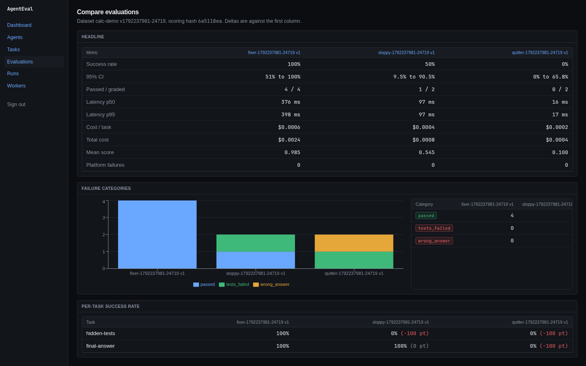
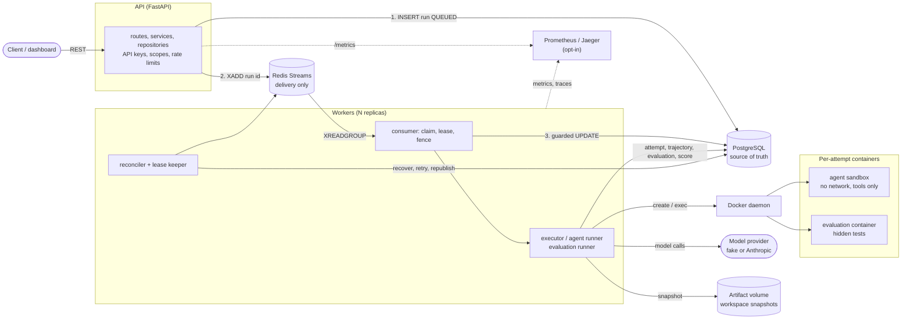
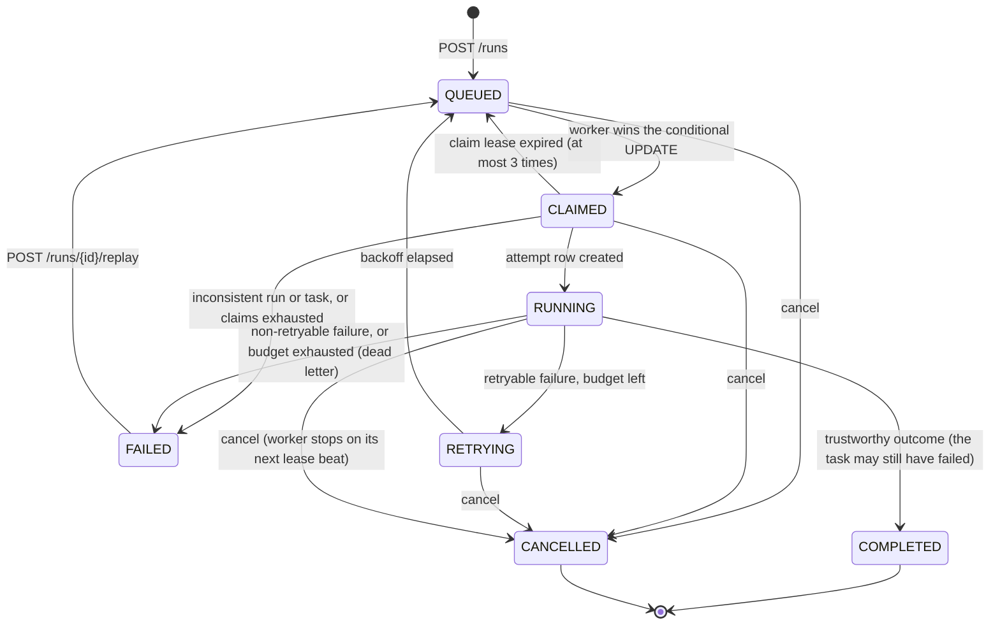
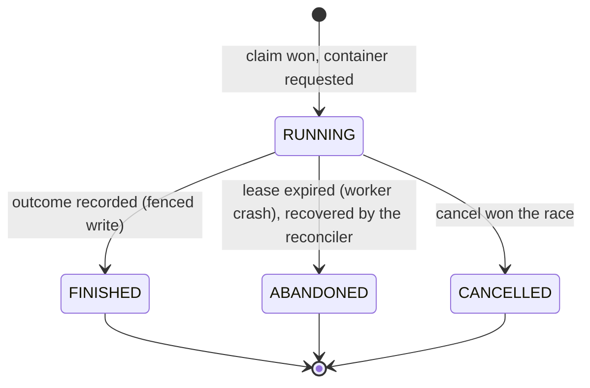
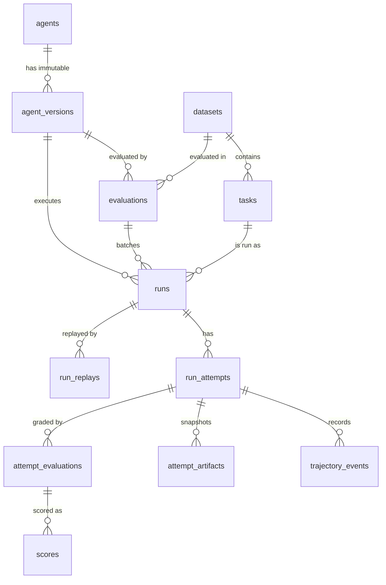
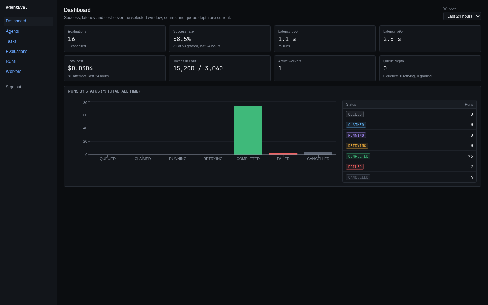
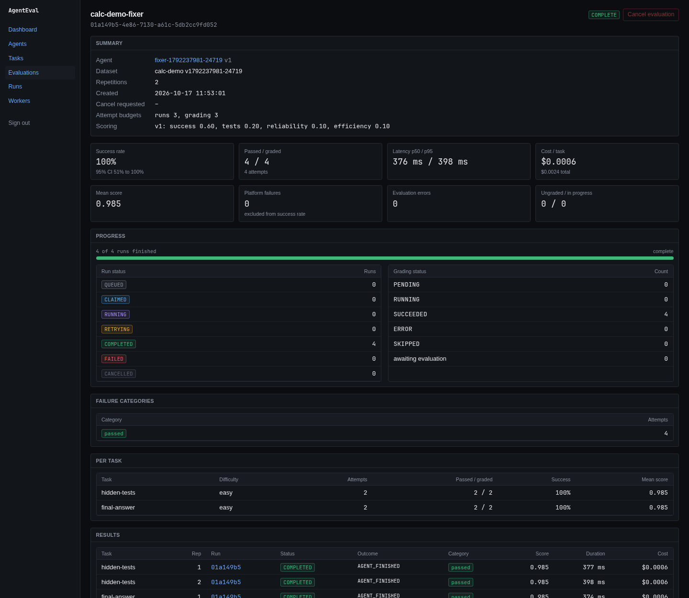
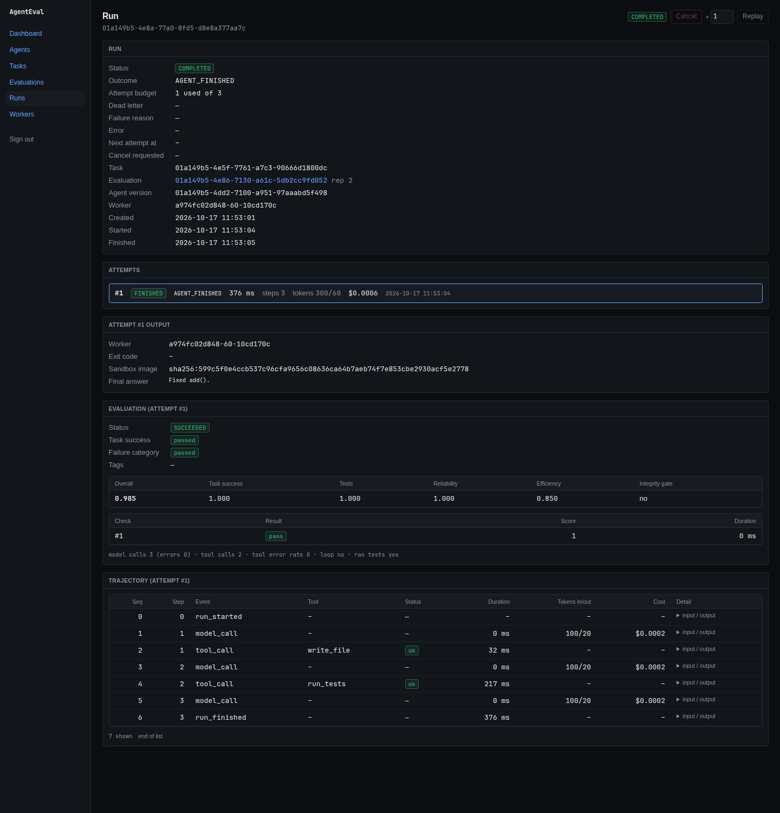

# AgentEval

[](https://github.com/Sanskriti10247/AgentEval/actions/workflows/ci.yml)
[](https://github.com/Sanskriti10247/AgentEval/actions/workflows/e2e.yml)

A platform for running, observing, evaluating and benchmarking AI agents inside controlled execution environments.



AgentEval is built to answer one question: given the same benchmark, how reliably, quickly and cheaply does each agent solve the tasks, and why does it fail when it doesn't?

You define an agent (a model, a system prompt, a set of tools, limits), a dataset of tasks, and optionally a hidden evaluation per task. The platform then:

1. queues one run per task and repetition, and executes them asynchronously on any number of workers;
2. runs each attempt in its own locked-down Docker container, where the agent works through six controlled tools under step, token, cost and time limits;
3. records the whole trajectory: every model call and tool call, with usage, cost, timings and errors;
4. grades the result in a separate, fresh container against hidden tests or expected outputs, assigns each attempt one failure category, and stores every score component;
5. retries platform failures with backoff, recovers from crashed workers, and dead-letters what it cannot recover;
6. summarises agents with a success rate and Wilson 95% interval, failure categories, latency and cost, and compares two to five agents on the same dataset;
7. shows it all in a Next.js dashboard, with Prometheus metrics and OpenTelemetry traces behind it.

Two kinds of task go through the same pipeline: a command task runs one command in a sandbox, and an agent task hands instructions to an agent. The default model provider is a deterministic scripted fake, so everything runs offline and for free; real Anthropic models are opt-in.

This is a portfolio project. It exists to show the engineering such a system needs: a state machine in Postgres, leases and fencing, at-least-once execution with exactly-once results, sandboxing, objective evaluation, observability, tests and benchmarks. It is not a hardened multi-tenant service, and its benchmark numbers come from one laptop. The rest of its limits are listed under [limitations](#limitations).

## Why it exists

Evaluating an agent is a systems problem as much as a modelling one, and most of the ways it goes wrong have nothing to do with the model.

A score only means something if the run was fair. An agent that "failed" because its container died or its worker crashed was never tested. AgentEval keeps the platform's verdict (`COMPLETED` or `FAILED`) apart from the task's verdict (`passed`, `tests_failed`, `wrong_answer`, ...), retries only platform faults, and leaves those out of the success rate instead of counting them against the agent.

Agents run untrusted code, which has to be isolated, bounded in time, memory and output, and kept away from credentials and from the answer key. The answer key matters most: if the agent can read the hidden tests, the benchmark measures nothing, so hidden data lives only in a separate evaluation container and never appears in an API response.

A single number also hides why an agent failed. Every attempt gets one failure category, its score components are stored separately, and its trajectory is kept. And since the work is long, flaky and costs money, it needs leases, retries, idempotency and recovery, so that a run is never lost, never recorded twice, and its cost is tracked.

What the project leaves out matters as much: no Kubernetes, no Kafka, and no agent framework. The agent loop is one module, `agent/runtime.py`. The whole system is one Postgres, one Redis and a handful of Docker containers.

## Architecture



The client talks only to the API. The API commits a run to Postgres before it publishes the run id to Redis, so a lost message is a delay, never a lost run. Workers claim runs with a conditional `UPDATE`, execute them in containers they create through the Docker daemon, and write every result back to Postgres under a fencing epoch. A reconciler in each worker repairs whatever crashes and lost messages leave behind.

One package, `agenteval_core`, holds the domain and is used by two process types, `api` and `worker` ([ADR-004](docs/decisions/ADR-004-modular-monolith-and-workers.md)). Postgres is authoritative and every state change is a guarded `UPDATE` ([ADR-002](docs/decisions/ADR-002-postgres-source-of-truth.md)). Redis Streams only deliver ids, runs on `runs.dispatch` and gradings on `evaluations.dispatch`, so duplicate or lost messages are harmless ([ADR-001](docs/decisions/ADR-001-redis-streams-for-dispatch.md)). Each attempt gets its own container ([ADR-003](docs/decisions/ADR-003-docker-execution-isolation.md)), driven by a hand-written, provider-neutral agent loop ([ADR-005](docs/decisions/ADR-005-agent-runtime.md)). The reasoning behind each choice, and what it cost, is summarised under [design decisions](#design-decisions).

### Tech stack

| Layer | Choice | Why |
| --- | --- | --- |
| Language, API | Python 3.12, FastAPI, Pydantic 2 | typed request and response models, async I/O |
| Database | PostgreSQL 16, SQLAlchemy 2 (async, asyncpg), Alembic | authoritative state, guarded updates, CHECK constraints, migrations (ADR-002) |
| Queue | Redis 7 Streams | delivery and consumer groups; never the source of truth (ADR-001) |
| Execution | Docker (Docker SDK for Python) | per-attempt isolation with resource limits (ADR-003) |
| Agent runtime | hand-written loop, `anthropic` SDK in the worker only | understandable, provider-neutral (ADR-005) |
| Observability | `prometheus-client`, OpenTelemetry (OTLP), structlog | metrics, traces, JSON logs (ADR-010) |
| Dashboard | Next.js 16 (React 19), TypeScript, Tailwind CSS 4, TanStack Query, Recharts | read-only view over the REST API |
| Edge | Caddy 2 | automatic TLS, headers, body cap (production only) |
| Tooling | uv, ruff, mypy, pytest (with testcontainers and hypothesis), Vitest, GitHub Actions | |

Every runtime dependency has its reason recorded in an ADR.

### Repository layout

```text
packages/core/agenteval_core/   the domain, shared by api and worker: models, schemas, repositories,
                                services, queue, states (state machine), auth, logging (redaction),
                                reliability/ (taxonomy, retry policy, leases, lease keeper),
                                artifacts/, agent/ (runtime loop, limits, pricing), providers/,
                                tools/ (the six tools), evaluation/ (pure grading domain and the
                                D11 public projection), observability/
packages/core/migrations/       Alembic migrations 0001 to 0010
apps/api/agenteval_api/         FastAPI app, scope guard, rate limiter, keys CLI, middleware, routes/
apps/worker/agenteval_worker/   consumer, executor, agent_runner, evaluation_runner, reconciler,
                                lease_manager, trajectory writer, sandbox/, providers/
apps/web/                       Next.js dashboard
benchmarks/                     the benchmark harness (run, matrix, sampler, report) and its tests
scripts/                        demo.sh, capture-screenshots.mjs
infrastructure/                 Dockerfiles (api, worker, web, sandbox), caddy/, monitoring/
tests/integration/, tests/e2e/  testcontainers Postgres 16 + Redis 7; the running compose stack
docs/                           ADRs, architecture, API, benchmarks, deployment, security review
docker-compose*.yml             dev stack; prod, e2e (short leases) and observability overrides
```

## How a run executes

```text
client ──HTTP──► api (FastAPI) ──1. INSERT run(QUEUED), COMMIT──► PostgreSQL  (source of truth)
                     │
                     └─2. XADD runs.dispatch {run_id}──► Redis Stream (delivery only)
                                                              │ XREADGROUP (group "workers")
                                                              ▼
                               worker (asyncio, N replicas, semaphore-bounded)
                                 3. UPDATE runs … WHERE status='QUEUED'   (conditional claim)
                                 4. attempt row + RUNNING, COMMIT, then XACK
                                 5. execute:
                                    command task → one exec in a sandbox container
                                    agent task   → AgentRunner: sandbox session + model loop,
                                                   trajectory events written as it goes
                                 6. persist outcome + terminal status (one fenced transaction)
                                 7. agent tasks: evaluate in a fresh container, then persist the
                                    evaluation + score (separate transactions, after step 6)
client ──GET /api/v1/runs/…, /evaluations/…──► api ──► PostgreSQL
```

`POST /api/v1/runs` commits the run as `QUEUED` and then publishes its id. If the publish fails the API answers 503, and retrying with the same `Idempotency-Key` re-dispatches the same run. The worker's claim is a conditional `UPDATE ... WHERE status='QUEUED'` that also sets a lease and bumps `lease_epoch`, so exactly one worker can win and duplicate messages are refused. The outcome, the terminal status and the attempt row are written in one fenced transaction (see [failure handling](#failure-handling)). For agent tasks with an evaluation spec, the workspace is snapshotted, the sandbox closed, and the attempt graded in a fresh container as a separate record.

A run has two columns that answer different questions. `runs.status` is the platform's lifecycle:

| `runs.status` | Meaning |
| --- | --- |
| `QUEUED` | persisted, waiting for a worker |
| `CLAIMED` | exactly one worker owns it (its conditional `UPDATE` won) |
| `RUNNING` | an attempt is executing |
| `RETRYING` | the last attempt failed with a retryable reason and budget is left; waiting for its backoff |
| `COMPLETED` | the platform produced a trustworthy outcome (the task may still have failed) |
| `FAILED` | the platform could not produce a trustworthy outcome (and, if `dead_letter_reason` is set, will not retry it; it can be replayed) |
| `CANCELLED` | a cancel request won: no outcome, no evaluation |

`outcome` is what happened to the task:

| `outcome` | Task type | Meaning | Status |
| --- | --- | --- | --- |
| `SUCCESS` | command | exit 0 within the time limit | COMPLETED |
| `NON_ZERO_EXIT` | command | exit ≠ 0, including an OOM kill (`oom_killed=true`, exit 137) | COMPLETED |
| `TIMEOUT` | both | the wall-clock limit was hit | COMPLETED |
| `AGENT_FINISHED` | agent | the model gave a final answer (no tool calls) | COMPLETED |
| `MAX_STEPS` | agent | the step limit was reached | COMPLETED |
| `BUDGET_EXCEEDED` | agent | the token or USD budget was reached | COMPLETED |
| `MODEL_REFUSAL` | agent | the model refused (the category is recorded) | COMPLETED |
| `MODEL_ERROR` | agent | the provider failed (retries or time exhausted, a non-retryable error, an unexpected stop) | FAILED |
| `SANDBOX_ERROR` | both | the sandbox couldn't be created, driven or kept alive | FAILED |
| `INTERNAL_ERROR` | both | cancellation (e.g. `cancelled: worker_shutdown`), an invalid config at run time, or a bug | FAILED |

`COMPLETED` never means the task was solved, only that the result can be attributed to the task or the agent. Whether the agent solved it is decided by the [evaluation](#evaluation), which is recorded separately. `FAILED` outcomes are platform faults, so the task was never fairly tested; they are the only ones retried, and only when the failure reason is retryable. The mapping lives in one pure function, `states.status_for()`, and the database enforces it with CHECK constraints.

The legal transitions (the full table with transition codes is in [ADR-009](docs/decisions/ADR-009-reliability-and-recovery.md)):



A claim whose lease expires before an attempt starts goes back to `QUEUED`, at most 3 times, after which the run is `FAILED` with `claim_abandoned`. A run has one or more attempts. Each attempt is one execution of the task in one sandbox, and carries the trajectory, the output and the evaluation:



An `ABANDONED` attempt makes the run `RETRYING` (or `FAILED` when the budget is spent), and the next attempt is a new row. The attempt's evaluation has its own status (`PENDING`, `RUNNING`, `SUCCEEDED`, `ERROR`, `SKIPPED`), so grading never changes what the attempt recorded.

## The agent runtime

```text
AgentRunner (worker)
  validate the agent version → open SandboxSession (task files copied)
  provider.start(system prompt, tool specs, task instructions)
  AgentRuntime.run:
    run_started
    loop: stop if cancelled / past deadline / max_steps / token or cost budget
          model call (in-step retries)                     → model_call
          refusal → MODEL_REFUSAL   no tool calls → AGENT_FINISHED
          tool calls, one at a time, then one results message → tool_call …
    run_finished
  close the sandbox (always)
→ finish_attempt(outcome, steps, tokens, cost, final answer)
```

Agent versions are immutable: a run references one exact config of model, system prompt, tools, shell allowlist, limits and provider settings. The config is normalised (defaults filled in, lists sorted) and hashed, so submitting an equivalent config returns the existing version. Models sit behind a neutral `ModelProvider` interface with two implementations: `fake`, the default, replays a JSON script stored in the version and is deterministic, offline and free; `anthropic` calls the Messages API and is opt-in.

The trajectory is a sequence of `run_started`, `model_call`, `model_error`, `tool_call`, `limit_reached` and `run_finished` events. It holds model usage and cost, visible text, tool inputs and outputs, errors and limits. Thinking blocks are never stored.

| Tool | What it does |
| --- | --- |
| `read_file` | `cat` a workspace file |
| `write_file` | create or overwrite a file (parent directories created) |
| `list_dir` | sorted listing, depth 1–3 |
| `search` | `grep` with regex or literal patterns; results sorted by file then line, capped |
| `shell` | run one command from the version's allowlist, as an argv list (no shell string) |
| `run_tests` | run the task's `test_command`; offered only when the task has one |

Paths are relative to `/workspace` and validated, and values supplied by the model reach the sandbox only as argv elements or positional `sh` parameters, never spliced into a shell string. Agent mistakes come back to the model as error results (`unknown_tool`, `invalid_input`, `denied`, `error`, `timeout`) so it can react; a failing command run through `shell` or `run_tests` is information, not an error. Output sent to the model is capped at 16 KiB, and the trajectory keeps up to 64 KiB.

No process outlives its tool call. Each command runs under `timeout --kill-after=1 <n>`, and afterwards a reaper SIGKILLs every process except PID 1, the container's keepalive and itself. An agent therefore can't leave a server running between calls, and shell state such as the current directory or environment doesn't carry over. Python bytecode caching is off for tool commands (`PYTHONDONTWRITEBYTECODE=1`), so the next run always sees an edit.

### Real models (opt-in)

Real model calls are off by default and the standard tests never need them. To enable Anthropic models:

```bash
# .env
AGENTEVAL_ENABLE_ANTHROPIC_PROVIDER=true    # read by both api (validation) and worker
ANTHROPIC_API_KEY=sk-ant-...                # passed to the worker container only
```

The supported models are `claude-opus-5`, `claude-opus-5-5`, `claude-sonnet-5`, `claude-fable-5-1` and `claude-haiku-4-5`, each in the price table at list prices as of 2026-09-28. Requests carry a system block with a cache breakpoint plus automatic caching, tools with `strict: true`, and adaptive thinking and the version's effort level where the model supports them (Haiku 4.5 takes neither). They never use SDK retries (the runtime retries and records each try), refusal fallbacks (a result must come from the model the version names), forced `tool_choice` or streaming. The worker refuses to start if the provider is enabled without a key. The one live test is described in [docs/testing.md](docs/testing.md).

## Evaluation

```text
attempt COMPLETED, and the spec needs the workspace → snapshot /workspace (tar.gz, ≤ 16 MiB) → close
finish_attempt COMMIT → EvaluationRunner (its own transactions):
  record PENDING (or SKIPPED: platform failure / no spec; ERROR: invalid spec, failed capture)
  claim → fresh container: snapshot → /workspace, hidden files → /eval (root-owned, read-only)
        → evidence + integrity → checks (workspace restored before each) → classify → score
  SUCCEEDED (+ score) | ERROR; the container is always removed
```

A spec combines check kinds: `python_tests` (a hardened runner that requires exit 0 and exactly the expected test count), `io` (stdout compared on the host), `command` (trusted environments only), `final_answer` and `file`, plus `protected_paths` for tamper detection.

Each attempt gets exactly one failure category, chosen by a fixed precedence: platform, evaluation error, tampering, passed, limits, behaviour, task result. Platform, evaluator and candidate failures stay distinct.

Scoring v1 is `0.60 task_success + 0.20 test_score + 0.10 reliability + 0.10 efficiency`. Every component is stored separately and tampering forces the score to 0. The weights are benchmark policy, so they are configurable per batch and hashed with it.

The success rate is passed ÷ graded, with a Wilson 95% interval. Platform failures, evaluator errors and tasks without a spec are left out of the denominator and reported separately.

The spec reference, the grading lifecycle and the statistics are in [docs/architecture/evaluation.md](docs/architecture/evaluation.md); the decisions are [ADR-006](docs/decisions/ADR-006-evaluation-and-scoring.md) and [ADR-007](docs/decisions/ADR-007-evaluation-secrecy.md).

## Data model



Postgres holds all persistent state; `workers` and `api_keys` stand alone. CHECK constraints tie `status`, `outcome`, `failure_reason` and `dead_letter_reason` together so that an impossible combination cannot be written, and every guarded `UPDATE` carries the expected status and `lease_epoch`. Grading writes its own rows (`attempt_evaluations`, then `scores` with every component and the scoring config hash) instead of rewriting the attempt. Workspace snapshots are files on a volume with a metadata row in Postgres ([ADR-008](docs/decisions/ADR-008-artifact-storage-and-trajectory-fence.md)). The diagram with columns, and the migrations, are in [docs/architecture/schema.md](docs/architecture/schema.md).

## Failure handling

Postgres decides and Redis only delivers ids. Every state change is one guarded `UPDATE` or one server-side function call, so a duplicate message, a stale worker or an overlapping reconciler can only be refused. The full design, with the transition tables and the failure-semantics table, is [ADR-009](docs/decisions/ADR-009-reliability-and-recovery.md); its settings are listed there and in [`.env.example`](.env.example).

Each run has an attempt budget, `max_attempts`, from 1 to 10 with a default of 3. An attempt that fails with a retryable reason (a transient model error, a sandbox fault, a worker shutdown, a lost lease) moves the run to `RETRYING`, waits `min(2 s × 2^(n-1), 60 s) × U(0.8, 1.2)`, and becomes a new attempt. Model calls are also retried inside a step. Whether a failure is retryable comes from a closed enum of failure reasons, never from error text, and completed outcomes (the agent finished, hit a limit, was refused, timed out) are never retried.

A claim sets a lease and bumps `lease_epoch`. A separate lease keeper process renews the worker's leases, and if renewals stop the worker stops itself shortly before a lease can expire. Once recovery has bumped the epoch, every write a stale owner attempts (heartbeat, trajectory, artifact, finish) matches zero rows.

The reconciler runs in every worker, with one advisory lock per step. It abandons and retries runs whose lease expired, requeues claims that never started, republishes `QUEUED` runs and due retries, reclaims pending stream entries, recovers expired and missing evaluations, marks silent workers lost, trims the streams, and sweeps orphaned containers and artifact files.

`POST /runs/{id}/cancel` cancels a queued or retrying run at once; a claimed or running run is flagged and its worker stops it on the next lease beat. Cancelling and finishing race deterministically: if the finish committed first, the API answers 409 and nothing changes. A cancelled attempt has no evaluation and no artifact.

A run that fails non-retryably, or exhausts its budget, ends `FAILED` with a `dead_letter_reason` of `non_retryable` or `retries_exhausted`. `GET /runs?dead_letter=true` lists them, `POST /runs/{id}/replay` gives it more attempts (1 to 9, within a total cap of 10), and the history is kept.

Grading has its own budget (`max_eval_attempts`), lease and retries. A grading failure never touches the attempt or its trajectory, and a worker crash during grading, or between finishing an attempt and recording its evaluation, is recovered by the reconciler. Because snapshots are files on a shared volume, any worker can grade any attempt.

The resulting guarantee is at-least-once execution with results recorded once: a recovered attempt re-runs the agent from the start, but fencing means only one result is ever written.

On a busy single host, sandbox containers must not starve heartbeats and cancellations, so `docker-compose.yml` gives `postgres`, `api` and `worker` a `cpu_shares` weight of 4096, four times Docker's default of 1024 (ADR-008). Sandbox containers keep the default weight. The weights only matter under contention.

## Observability

The API serves `/metrics` and each worker serves its own on port 9464. Labels come from closed sets, never ids, and system-state gauges are read from Postgres and Redis at scrape time. Traces use OpenTelemetry and follow a run across the Redis hop, from the API request through the worker, the agent's model and tool calls, to grading. Spans are always created, so every log line inside one carries `trace_id` and `span_id`, but nothing is exported unless an OTLP endpoint is configured. Span attributes come from an allow-list of ids, enums, sizes, durations, token counts and cost, so prompts, model output, file contents and hidden checks have nowhere to go.

```bash
docker compose --profile observability up -d prometheus   # Prometheus UI on http://127.0.0.1:9090
make observability-up                                      # Prometheus + Jaeger (UI on http://127.0.0.1:16686)
make observability-down
```

The metric families, example PromQL, the span tree and the tracing configuration are in [docs/observability.md](docs/observability.md).

## Security model

This is a research and portfolio sandbox, not a hardened multi-tenant security boundary. It runs untrusted code in containers that share the host kernel, and its worker holds the Docker socket, which is root-equivalent on the host. Run it on a dedicated machine, for callers you trust with that machine. The full review, with the threat model, trust boundaries, controls per threat, findings and accepted risks, is [docs/security-review.md](docs/security-review.md).

Each sandbox (`apps/worker/agenteval_worker/sandbox/session.py`) has no network (`network_mode=none`); a memory limit with no swap, a CPU quota and `pids_limit=128`; a read-only root filesystem with size-capped tmpfs at `/workspace` and `/tmp`, mounted `noexec,nosuid,nodev`; uid 1000, all capabilities dropped, `no-new-privileges`, Docker's default seccomp profile and tini as PID 1; and wall-clock limits and output caps. The container is always removed. Agent tools add a per-call timeout, the post-call reaper, argv-only execution and an allowlist for `shell`. The allowlist and path checks are policy, not the isolation boundary: the container is the boundary, and an agent allowed `sh` can do anything the container permits. Prompt injection through task files and tool output is expected; its reach is limited to the version's tools inside the container, and a runaway agent is stopped by its step, token, cost and time limits.

The evaluation container has the same controls, plus `noexec,nosuid,nodev` on every writable mount and the hidden files in a root-owned, read-only `/eval`. Snapshots are validated header by header on the host and only ever unpacked inside a sandbox. Hidden files, check names, expected values and evaluator configuration never appear in API responses or anything the model sees: specs are write-only, every response goes through one public projection, and 422s are sanitised. Evaluation log events carry only ids, statuses and categories, with one exception: an unexpected evaluator exception is logged with its traceback for the operator.

Model credentials live only in the worker's environment. They are never passed into a sandbox (a test inspects a live one) and never put in prompts. Structured logs redact `sk-ant-…` values, `ae_…` API keys, `Bearer …` text and credential-named fields (`api_key`, `authorization`, `x-api-key`, …). Tasks may only use images listed in `AGENTEVAL_IMAGE_ALLOWLIST`, checked by the API at task creation and again by the worker before it creates a container; the worker never pulls images.

Because the worker mounts `/var/run/docker.sock`, it is a trusted component and runs as root in its container, with all Linux capabilities dropped in production. The API has no socket access, runs as a non-root user, and its image installs neither the Docker SDK nor the Anthropic SDK.

Every `/api/v1` request needs an API key (`ae_<prefix>_<secret>`, 256 bits of randomness, stored only as a SHA-256 and compared in constant time). Keys have `read`, `write` and `admin` scopes, can expire and can be revoked, and a test fails if any route lacks a scope. The first key is minted by an operator CLI inside the API container; there is no anonymous endpoint for it. `/health`, `/ready` and `/metrics` are open, and `/metrics` is meant for the internal network only (the production proxy answers it with 404). Each key has a per-minute budget of 600 reads and 120 writes, counted in Redis and answered with 429 and `Retry-After`; it fails open if Redis is down, since Redis is never the authority. Request bodies are capped at 5 MiB (`AGENTEVAL_MAX_REQUEST_BYTES`, 413), tasks and specs have their own size and count limits, 422s never echo the input, and a value Postgres cannot store is a fixed-text 422 rather than a 500. Details: [docs/api/auth.md](docs/api/auth.md) and [ADR-012](docs/decisions/ADR-012-production-polish.md).

In production only Caddy is published, with TLS, HSTS, `X-Frame-Options`, a framing-and-injection CSP and a 5 MB body cap. Postgres and Redis need passwords and are not published. The api, worker, web and Caddy containers drop all capabilities and set `no-new-privileges`, and the API has a read-only root filesystem. The dashboard sets the same headers when served directly. Dependencies are audited in CI (`pip-audit` on the locked set, `npm audit` on the production set), and the last audit reported no advisories. In development, compose binds every port to `127.0.0.1`.

## Quick start

You need [uv](https://docs.astral.sh/uv/) and Docker with Compose v2 (Docker Desktop on macOS works). Node.js 22 and npm are only needed for `make web` and `make web-check` (`make web-up` builds the dashboard in Docker), and `curl` and `jq` for the [demo](#demo).

```bash
cp .env.example .env     # optional; defaults work
make sync                # uv sync --all-packages (Python 3.12 is pinned; uv fetches it)
make up                  # builds the sandbox image, starts postgres, redis, api, worker
make migrate             # alembic upgrade head (inside the api container)
# Authentication is on: create a key once (it is shown once; only its hash is stored)
docker compose exec api python -m agenteval_api.keys create --name me --scopes read,write,admin
export AGENTEVAL_API_KEY=ae_...        # paste the key it printed
make e2e                 # full-stack tests over real HTTP
make logs / make down
```

Every `/api/v1` call needs the key as `Authorization: Bearer <key>`. `make e2e` and `make bench-smoke` use `AGENTEVAL_E2E_API_KEY` / `AGENTEVAL_BENCH_API_KEY` if set, and otherwise create a short-lived key themselves. `AGENTEVAL_AUTH_ENABLED=false` switches the checks off for local experiments.

Host ports default to 55432 (Postgres), 56379 (Redis) and 8000 (API); Postgres and Redis avoid the standard ports so they don't clash with local instances, and all three can be changed in `.env`. Compose reads `.env` for variable substitution only, so it changes just what `docker-compose.yml` references: the host ports, `AGENTEVAL_LOG_LEVEL`, `AGENTEVAL_AUTH_ENABLED`, the two rate limits, `AGENTEVAL_WORKER_CONCURRENCY`, `AGENTEVAL_WORKER_METRICS_PORT`, the Anthropic settings and the dashboard build URL. The other settings in `.env.example` (leases, caps, CORS, ...) apply to processes started outside compose; to change one in compose, add it to the service's `environment`. The API and the worker both reload on code changes (the worker through `watchfiles`, draining in-flight runs first). Scale out with `docker compose up -d --scale worker=3`.

### A command task

```bash
AUTH="Authorization: Bearer $AGENTEVAL_API_KEY"
curl -s -H "$AUTH" -X POST localhost:8000/api/v1/tasks -H 'content-type: application/json' -d '{
  "name": "hello", "image": "agenteval-sandbox:py312",
  "command": ["python", "main.py"],
  "files": {"main.py": "print(\"hi\")\nraise SystemExit(3)"},
  "timeout_s": 10
}'
# -> {"id": "<task_id>", ...}

curl -s -H "$AUTH" -X POST localhost:8000/api/v1/runs -H 'content-type: application/json' \
     -H 'Idempotency-Key: demo-1' -d '{"task_id": "<task_id>"}'
# -> 202 {"id": "<run_id>", "status": "QUEUED", ...}

curl -s -H "$AUTH" localhost:8000/api/v1/runs/<run_id>            # status COMPLETED, outcome NON_ZERO_EXIT
curl -s -H "$AUTH" localhost:8000/api/v1/runs/<run_id>/attempts   # exit_code 3, stdout "hi\n"
```

### An agent task (scripted fake model, offline and free)

```bash
AUTH="Authorization: Bearer $AGENTEVAL_API_KEY"
API=localhost:8000/api/v1
curl -s -H "$AUTH" -X POST $API/agents -H 'content-type: application/json' -d '{"name": "fixer"}'
# -> {"id": "<agent_id>", ...}

curl -s -H "$AUTH" -X POST $API/agents/<agent_id>/versions -H 'content-type: application/json' -d '{
  "model_provider": "fake", "model": "fake-model",
  "system_prompt": "You fix bugs.",
  "tools": ["read_file", "write_file", "run_tests"],
  "limits": {"max_steps": 10},
  "model_settings": {"script": [
    {"type": "turn", "tool_calls": [{"name": "run_tests"}]},
    {"type": "turn", "tool_calls": [{"name": "write_file",
       "input": {"path": "calc.py", "content": "def add(a, b):\n    return a + b\n"}}]},
    {"type": "turn", "tool_calls": [{"name": "run_tests"}]},
    {"type": "turn", "text": "Fixed add().", "expect_tool_results_contain": ["Tests passed."]}
  ]}
}'
# -> 201 {"id": "<version_id>", "version": 1, "config_hash": "...", ...}

curl -s -H "$AUTH" -X POST $API/tasks -H 'content-type: application/json' -d '{
  "name": "fix-add", "task_type": "agent", "image": "agenteval-sandbox:py312",
  "instructions": "The tests fail. Fix calc.py so they pass.",
  "test_command": ["python", "-m", "unittest", "-q"],
  "files": {"calc.py": "def add(a, b):\n    return a - b\n",
            "test_calc.py": "import unittest\nfrom calc import add\nclass T(unittest.TestCase):\n    def test(self):\n        self.assertEqual(add(2, 3), 5)\n"},
  "timeout_s": 120
}'
curl -s -H "$AUTH" -X POST $API/runs -H 'content-type: application/json' \
     -d '{"task_id": "<task_id>", "agent_version_id": "<version_id>"}'

curl -s -H "$AUTH" $API/runs/<run_id>                        # COMPLETED / AGENT_FINISHED
curl -s -H "$AUTH" $API/runs/<run_id>/attempts               # steps 4, tokens_in 400, tokens_out 80, cost_usd "0.000800"
curl -s -H "$AUTH" "$API/runs/<run_id>/attempts/1/events?limit=100"   # the trajectory, in seq order
```

### Dashboard

The dashboard (`apps/web`) reads the public REST API and has no database access. It shows KPIs and charts, agents and their versions, tasks, evaluations with a side-by-side comparison of up to five, runs (with the dead-letter view, the trajectory, cancel and replay) and workers.

```bash
make web-up                 # the dashboard container on http://localhost:3000 (compose profile "web")
make web                    # or: a dev server with hot reload on :3000 (npm ci + npm run dev)
make web-check              # typecheck, lint, tests and production build
```

The service is opt-in (profile `web`), so `make up` and the e2e runs never pay for a Node build; compose serves it on `127.0.0.1:${AGENTEVAL_WEB_HOST_PORT:-3000}`. The browser calls the API directly, so `NEXT_PUBLIC_API_URL` (build arg `AGENTEVAL_WEB_API_URL`, default `http://localhost:8000`) is baked into the bundle at build time, and the API's `AGENTEVAL_CORS_ORIGINS` must contain the dashboard's origin. On first use it asks for an API key, which it keeps in the tab's `sessionStorage`; a `read` key can browse, and cancel and replay need `write`. Key handling and the page-to-endpoint map are in [apps/web/README.md](apps/web/README.md).

### Deployment

`docker-compose.prod.yml`, applied on top of `docker-compose.yml`, runs the stack on a single dedicated host: images by tag, no source mounts or reload, `restart: unless-stopped`, resource limits, secrets from an env file outside the repository (`.env.prod.example`), and Caddy with automatic TLS as the only published service (ports 80 and 443). Postgres, Redis and the metrics ports stay on the internal network. `make prod-config` checks that the production compose files parse, using throwaway secrets and starting nothing. Release images are published to GHCR on version tags by `.github/workflows/release.yml`. The first deploy, upgrades, backups, rollback, the Docker-socket caveat and sizing are in [docs/deployment.md](docs/deployment.md).

## Demo

`scripts/demo.sh` walks through the core loop against a running stack. It creates three scripted agents, one dataset of two tasks with hidden checks, and one evaluation per agent, then prints the summaries and a comparison. It uses the fake model provider, so it is offline, free and deterministic.

```bash
make up && make migrate
docker compose exec -T api python -m agenteval_api.keys create --name demo --scopes read,write,admin
export AGENTEVAL_API_KEY=ae_...          # the key it printed (shown once)
./scripts/demo.sh                        # a few seconds on a warm stack
```

The three agents each have one immutable version: `fixer` edits `calc.py` and runs the tests, `sloppy` edits it wrongly and never checks, and `quitter` gives up. One task is graded by a hidden test file plus a protected-path (tamper) check, the other by a final-answer check. The dataset is frozen so its tasks can't change under a benchmark, and every agent is evaluated on it, the fixer with 2 repetitions. Because the agents are scripted, the output is the same on every run:

| Agent | Graded | Passed | Success rate | 95% CI | Failure categories | Mean score |
| --- | --- | --- | --- | --- | --- | --- |
| fixer | 4 | 4 | 100% | 51% to 100% | `passed: 4` | 0.985 |
| sloppy | 2 | 1 | 50% | 9.5% to 90.5% | `passed: 1`, `tests_failed: 1` | 0.545 |
| quitter | 2 | 0 | 0% | 0% to 65.8% | `tests_failed: 1`, `wrong_answer: 1` | 0.100 |

The fixer's interval is wide because four graded attempts say little, which is why the interval is reported at all. The sloppy agent passes the final-answer task by claiming success and fails the hidden test, which is what the hidden test is for. The per-result rows show only the public projection (status, category, tags, per-position check results, score components and metrics); hidden test names and expected values never appear.

The script ends by printing dashboard links; with `make web-up` running, open <http://localhost:3000>, paste the key, and the evaluation and compare pages show the same numbers. It exits non-zero if the agents don't score as designed (fixer 4 of 4, quitter 0 of 2), so it also works as a smoke test of a deployment.

### Screenshots

These are captured from the running dashboard with the demo's data by `scripts/capture-screenshots.mjs`. The comparison of the three agents is the image at the top of this page.







To regenerate them:

```bash
EV=$(./scripts/demo.sh | sed -n 's/^EVALUATIONS=//p')
AGENTEVAL_EVALUATIONS=$EV node scripts/capture-screenshots.mjs     # needs chromium and Node 22+
```

## Benchmarks

The platform itself is benchmarked with a reproducible harness in `benchmarks/`; the method is [ADR-011](docs/decisions/ADR-011-benchmarking.md). The numbers below are copied from the generated report, [docs/benchmarks/README.md](docs/benchmarks/README.md), which also has the latency percentiles, CPU and memory tables, and the limitations. Reproduce them with `make bench-smoke` (seconds) or `make bench` (about an hour, and it wipes the stack's data; see [benchmarks/README.md](benchmarks/README.md)).

Throughput with 2 workers × 2 slots, 3 repeats per cell, as the median with the min–max range. `noop-command` runs `true` in a sandbox, so it measures dispatch, claim, container create, start and remove, and persistence:

| Runs | Repeats | Throughput (runs/s) | Success rate | Retry rate | Submit phase (s, client) |
|---|---|---|---|---|---|
| 10 | 3 | 3.25 (3.22-3.33) | 1.000 (1.000-1.000) | 0.000 (0.000-0.000) | 0.17 (0.16-0.18) |
| 100 | 3 | 3.84 (2.46-4.27) | 1.000 (1.000-1.000) | 0.000 (0.000-0.000) | 1.30 (1.06-1.62) |
| 500 | 3 | 4.09 (3.71-4.11) | 1.000 (1.000-1.000) | 0.000 (0.000-0.000) | 6.62 (4.25-7.18) |
| 1000 | 3 | 3.98 (3.97-4.01) | 1.000 (1.000-1.000) | 0.000 (0.000-0.000) | 10.77 (10.06-13.01) |

`fake-agent` adds the scripted agent loop, trajectory writes and grading:

| Runs | Repeats | Throughput (runs/s) | Throughput incl. grading (runs/s) | Success rate | Retry rate | Submit phase (s, client) |
|---|---|---|---|---|---|---|
| 10 | 3 | 3.66 (3.02-3.70) | 3.63 (3.00-3.67) | 1.000 (1.000-1.000) | 0.000 (0.000-0.000) | 0.17 (0.16-0.22) |
| 100 | 3 | 2.87 (2.74-3.05) | 2.86 (2.74-3.05) | 1.000 (1.000-1.000) | 0.000 (0.000-0.000) | 1.47 (1.12-2.58) |
| 500 | 3 | 2.99 (2.95-3.04) | 2.99 (2.95-3.04) | 1.000 (1.000-1.000) | 0.000 (0.000-0.000) | 5.10 (5.09-5.57) |
| 1000 | 3 | 3.00 (2.91-3.06) | 3.00 (2.91-3.06) | 1.000 (1.000-1.000) | 0.000 (0.000-0.000) | 12.72 (11.81-13.07) |

Worker scaling, `noop-command`, 200 runs, 2 slots per worker:

| Workers | Throughput (runs/s) | Speedup | Efficiency | Exec p50 (s) |
|---|---|---|---|---|
| 1 | 3.11 | 1.00 | 100% | 0.685 |
| 2 | 4.03 | 1.30 | 65% | 1.046 |
| 5 | 4.25 | 1.37 | 27% | 2.321 |
| 10 | 4.90 | 1.58 | 16% | 3.722 |
| 25 | 4.41 | 1.42 | 6% | 10.988 |

These ran on one developer laptop shared with unrelated containers, so the absolute numbers are indicative and the shape is what matters. Every run succeeded with no retries. Submission is a burst, so queue latency is mostly the backlog. Throughput flattens at about 4 to 5 runs per second because each sandbox takes longer the more of them run at once; the data is consistent with the Docker daemon being the limit but does not prove it. Sandbox CPU and memory could not be measured, and nothing here is a claim about other hardware.

## Testing

| Layer | Where | What it covers | Needs |
| --- | --- | --- | --- |
| Unit | `packages/core/tests`, `apps/*/tests`, `benchmarks/tests` | state machines, failure taxonomy, retry policy and backoff, lease timing, scoring and statistics, evaluators and parsers, the agent loop against a scripted provider, metrics, key format and redaction, middleware | nothing |
| Integration | `tests/integration` | the real API, Redis, Postgres (testcontainers, real migrations) and, where marked, Docker: every transition and constraint, fencing, locks, each reconciler step, the whole auth and scope matrix, the read API, migrations | Docker |
| Sandbox | `apps/worker/tests` | the container controls from the inside, the tools in a real sandbox, evaluation attacks and secrecy | Docker, `make sandbox-image` |
| End-to-end | `tests/e2e` | the running compose stack over real HTTP: submit, execute, evaluate, read back | `make up && make migrate` |
| Failure | spread across the layers | worker crash (SIGKILL mid-run and mid-grading), timeouts, retries, duplicate dispatch, invalid tasks, model API failure, evaluator failure, cancellation, dead letter and replay | as above |
| Dashboard | `apps/web/tests` | pages render from fixtures, the key screen, error states, response headers | `make web-check` |

```bash
make test        # unit + integration + real-Docker tests (no network, no API key)
make test-unit   # no Docker needed
make e2e         # needs `make up && make migrate`; recreates the worker with short lease timings
make lint        # ruff + mypy
```

CI runs the Docker-free layers and the full integration run on every push and pull request; the end-to-end suite runs on `main` and nightly. The security tests inspect live containers rather than the code that configures them, and the timing-sensitive tests wait for the condition they assert instead of racing it. The CI jobs, what each phase's tests cover, the e2e configuration and the formerly flaky tests are described in [docs/testing.md](docs/testing.md).

## API

The OpenAPI docs are served at <http://localhost:8000/docs>. Every `/api/v1` route needs a key with the route's scope (`read` for `GET`, `write` for changes, `admin` for `/keys`), errors are RFC 7807-style `application/problem+json`, and lists are keyset-paged. The route table, the status codes for submitting a run, and the task and agent-version limits are in [docs/api/README.md](docs/api/README.md), which links to the pages for authentication, evaluations and the dashboard's read endpoints.

## Design decisions

Each major choice has an Architecture Decision Record; the index is [docs/decisions/README.md](docs/decisions/README.md), which also lists where implementation departed from the original plan.

| Decision | Chosen | Instead of | Cost accepted |
| --- | --- | --- | --- |
| Source of truth | Postgres, guarded `UPDATE`s, CHECK constraints (ADR-002) | Redis state, an ORM unit of work | more SQL; correctness is testable in one place |
| Dispatch | Redis Streams, reconciler republishes (ADR-001) | Kafka, Celery, a plain list | at-least-once delivery, handled by the conditional claim |
| Isolation | one Docker container per attempt (ADR-003) | in-process execution, a VM per task | shared kernel; the worker needs the Docker socket |
| Process model | modular monolith, API and worker from one package (ADR-004) | microservices | one deploy unit, one codebase to reason about |
| Agent loop | hand-written, provider-neutral (ADR-005) | an agent framework | more code to own, fully understood |
| Evaluation | separate record, fresh hardened container, hidden specs write-only (ADR-006, ADR-007) | grading inside the agent's sandbox, returning the spec | operators can't read back a spec they wrote |
| Artifacts | files on a volume, metadata in Postgres (ADR-008) | blobs in Postgres, an object store | single host |
| Reliability | leases with epoch fencing, at-least-once execution, exactly-once results (ADR-009) | exactly-once execution claims | a recovered attempt re-runs the agent and pays for it again |
| Observability | Prometheus, OpenTelemetry, labels from closed sets (ADR-010) | free-form labels and logged payloads | no prompts or outputs in traces |
| Benchmarks | open-loop burst on one host, reported with its limits (ADR-011) | a tuned, paced demo | numbers are indicative, not general |
| Auth | opaque API keys with scopes, fail-open rate limits (ADR-012) | OAuth, JWTs | no users, no per-object ownership |

## Limitations

Isolation and access:

- Sandboxes share the host kernel, so a kernel exploit is not mitigated beyond Docker's defaults.
- Authentication is API keys only: no users, no OAuth, no per-object ownership, no per-user audit beyond the key name, and no automated key rotation. Keys are bearer credentials, so anyone holding one has its scopes. TLS is terminated by the production reverse proxy (Caddy), not by the API, and the development stack is plain HTTP on localhost.
- The dashboard keeps its key in `sessionStorage`, which any script running on the dashboard's origin can read.
- `AGENTEVAL_AUTH_ENABLED=false` removes all access control and is for local experiments only.

Reliability:

- Execution is at least once. A recovered or retried attempt re-runs the agent from the start and pays for its model calls again; only the recorded result is exactly-once.
- Everything assumes one host. Container kills, the orphan sweeps and the artifact volume assume one Docker daemon, and the artifact store is a local named volume shared by the workers on that host. Several hosts would need an object store behind `ArtifactStore` and per-host sweeps.
- Recovery needs a live worker, because the reconciler runs inside the workers. It takes about one lease TTL (30 s by default), and cancelling a running run takes up to one heartbeat (10 s) plus the runtime's next check.
- Failure handling is tested and the happy path is benchmarked, but crashes under load are not: the benchmarks inject no faults, and the crash scenarios are functional tests.
- A batch created without an `Idempotency-Key` whose dispatch fails isn't re-dispatched by the client; the reconciler republishes its `QUEUED` runs instead.

Agent runs:

- Budgets are checked between model calls, so the worst case overshoots by one call.
- Model calls are non-streaming.
- Costs are list-price estimates, with no batch or volume discounts and 5-minute cache writes only.
- A tool that leaves a process holding stdout takes about 2 s longer, because of Docker's stream drain.
- Agent-task files and tool writes use real mtimes, but command-task files keep `tar`'s mtime 0 so command execution stays as it was. A command task using `make`, or anything else that compares timestamps, could still misbehave (decided in Phase 4 as C8).

Evaluation:

- There is no rescoring endpoint and no way to re-run checks, though score storage already supports rescoring.
- Evaluation containers use the task's image tag. The agent's resolved image ID is recorded, but grading isn't verified against it.
- `python_tests` checks fail closed if the image has no pytest, which is recorded as `tests_failed`.
- Candidate code runs inside the test process, so it can read `/eval` while being graded and could cheat in-process (C7). `io` checks are the robust choice when integrity matters most.
- Public per-check scores and positions reveal how many hidden tests and checks exist, though nothing model-visible does.
- Specs are write-only, even for their author.
- Summaries are computed in memory over at most 1000 runs per batch.
- There is no LLM-as-judge.

The benchmark caveats are under [benchmarks](#benchmarks).

## Future work

Roughly in the order it would matter:

- Stronger isolation: gVisor or Firecracker for the sandboxes, and a Docker socket proxy or rootless Docker so the worker no longer needs to be root-equivalent. See the [security review](docs/security-review.md).
- Multi-host operation: an object-store backend behind `ArtifactStore`, per-host container sweeps and kills, and the reconciler's single-host assumptions lifted.
- Rescoring and re-checking: an API to re-run the checks against a stored snapshot, and a re-gradable `ERROR` state.
- LLM-as-judge for tasks without objective checks, with its limitations documented and never as the only signal.
- More model providers behind the existing `ModelProvider` interface (OpenAI, Gemini), and batch or volume pricing in the cost estimates.
- Users and ownership: OAuth or OIDC, per-user audit, per-object ownership, and a least-privilege split of database roles.
- Live updates in the dashboard (server-sent events instead of polling) and richer failure drill-downs.
- Better benchmarks: paced (closed-loop) submission, sampling the Docker daemon and the sandboxes themselves, and fault injection under load.
- Streaming model calls, and budgets enforced within a call rather than between calls.

## Documentation

| Document | Covers |
| --- | --- |
| [docs/decisions/](docs/decisions/README.md) | ADR-001 to ADR-012, and deviations from the original plan |
| [docs/architecture/evaluation.md](docs/architecture/evaluation.md) | the evaluation spec, grading lifecycle, scoring and statistics |
| [docs/architecture/schema.md](docs/architecture/schema.md) | the database schema with columns, and the migrations |
| [docs/api/](docs/api/README.md) | every route, limits and validation rules, auth, evaluations, read endpoints |
| [docs/observability.md](docs/observability.md) | metric families, PromQL, tracing |
| [docs/security-review.md](docs/security-review.md) | threat model, controls, findings, accepted and residual risks |
| [docs/testing.md](docs/testing.md) | CI jobs, coverage by area, e2e configuration |
| [docs/benchmarks/](docs/benchmarks/README.md) | the full benchmark report |
| [docs/deployment.md](docs/deployment.md) | running it on a single host |
| [apps/web/README.md](apps/web/README.md) | the dashboard |
