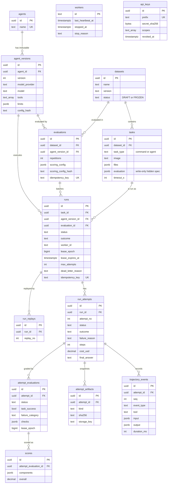

# Database schema

Postgres holds all persistent state. The models in `packages/core/agenteval_core/models/` are the source, and Alembic migrations `0001` to `0010` build the schema. The diagram shows the main tables and the columns the rest of the documentation refers to, not every column.

`workers` and `api_keys` stand alone. A run records the id of the worker that owns it, but there is no foreign key, so a worker row can be pruned without touching history.

## Design notes

- The database enforces state, not just the code. CHECK constraints tie `status`, `outcome`, `failure_reason` and `dead_letter_reason` together, so an impossible combination cannot be written.
- Every state change is a guarded `UPDATE`, or a server-side function for the terminal writes. The `WHERE` clause carries the expected status and `lease_epoch` ([ADR-002](../decisions/ADR-002-postgres-source-of-truth.md), [ADR-009](../decisions/ADR-009-reliability-and-recovery.md)).
- The evaluation is a separate row from the attempt (`attempt_evaluations`, then `scores`), so grading never rewrites what the attempt recorded.
- Scores store each component separately, with the scoring configuration and its hash, never only one number.
- Large artifacts are files, not rows. Workspace snapshots live on a volume, with a metadata row (`storage_key`, size, SHA-256) in Postgres ([ADR-008](../decisions/ADR-008-artifact-storage-and-trajectory-fence.md)).

## Migrations

| Migration | Adds |
| --- | --- |
| `0001` | tasks, runs, attempts |
| `0002` | the agent runtime (agents, versions, trajectory) |
| `0003` | datasets, evaluations, artifacts, attempt evaluations, scores |
| `0004`–`0009` | reliability: leases, failure reasons, budgets, worker stop reasons, evaluation leases, replays |
| `0010` | `api_keys` |

Several of these refuse to downgrade once their data exists; see [deployment.md](../deployment.md#downgrades).
