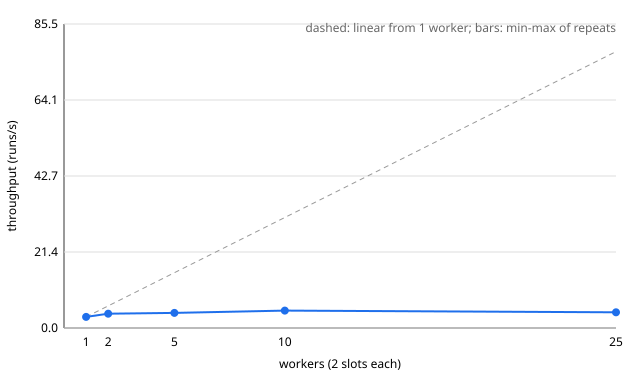

# Platform benchmarks (Phase 7)
Generated by `uv run python -m benchmarks.report` from the result files in `benchmarks/results/`. Every number below comes from those files; nothing is estimated.
## Machine and environment

- CPU: 13th Gen Intel(R) Core(TM) i5-13420H, `nproc` = 12
- RAM: 15687 MiB total; MemAvailable at scenario start ranged 2546-4974 MiB; swap 15686 MiB
- Kernel 7.2.5-3-omarchy; Docker server 29.7.2
- Host 1-minute load average at scenario start: 2.30-27.51
- Code: `09b6df8001` (working tree had uncommitted changes)
- Run window: 2026-10-17T09:31:12.167705+00:00 to 2026-10-17T10:34:09.962447+00:00 (UTC)
- Stack: the repository's `docker-compose.yml` as is (api with `--reload`, worker under `watchfiles`, Postgres 16, Redis 7), observability profile off; worker settings per scenario are stored in each result file
- **Other containers running on the host during the benchmarks (unrelated stacks, not controlled by us):** `clinicflow-control-plane`, `clinicflow-worker`, `clinicflow-worker2`, `knowops-frontend`, `knowops-tunnel`, `session20-control-plane`

## Method

Defined in [ADR-011](../decisions/ADR-011-benchmarking.md); reproduce with
[`benchmarks/README.md`](../../benchmarks/README.md).

- A *scenario* = one workload x run count x worker setup. The harness scales the compose `worker`
  service to the requested count, waits until exactly that many are alive in `GET /api/v1/workers`,
  empties the data tables, creates one task, submits all runs concurrently over HTTP
  (`max_attempts` = 1, so a retry can never hide a failure), waits until every run is terminal (and,
  for `fake-agent`, graded), then reads the timings from Postgres.
- Workloads: `noop-command` runs `true` in `agenteval-sandbox:py312` (128 MB, 30 s limit) and so
  exercises dispatch, claim, container create/start/remove and persistence. `fake-agent` runs the
  scripted fake model (list_dir, read_file, final answer; no network, no cost) with a final-answer
  evaluation, and so adds the agent loop, trajectory writes and grading.
- Latencies come from server-side timestamps in Postgres: queue = `claimed_at - created_at`,
  start = `started_at - claimed_at`, exec = attempt `finished_at - started_at`, end-to-end =
  `finished_at - created_at`, grading = evaluation `finished_at - attempt finished_at`.
  Percentiles use linear interpolation between closest ranks. Throughput = finished runs /
  (last `finished_at` - first `created_at`).
- Success = run COMPLETED with the workload's expected outcome (and, for `fake-agent`, a SUCCEEDED
  evaluation with `task_success`). Retry rate = runs with more than one attempt.
- Resource use: `docker stats --no-stream` of the api, worker, postgres and redis containers and of
  any sandbox container, summed per role. One `docker stats` call takes about two seconds, so the
  cadence is about 2 s, not 1 s (the actual mean interval and sample count are stored per result).
- Each cell has its repeats listed in its table's *Repeats* column; values are the median over the
  repeats with the min-max range in parentheses.

## Throughput: `noop-command` (2 workers x 2 slots)

**Throughput and rates**

| Runs | Repeats | Throughput (runs/s) | Success rate | Retry rate | Submit phase (s, client) |
|---|---|---|---|---|---|
| 10 | 3 | 3.25 (3.22-3.33) | 1.000 (1.000-1.000) | 0.000 (0.000-0.000) | 0.17 (0.16-0.18) |
| 100 | 3 | 3.84 (2.46-4.27) | 1.000 (1.000-1.000) | 0.000 (0.000-0.000) | 1.30 (1.06-1.62) |
| 500 | 3 | 4.09 (3.71-4.11) | 1.000 (1.000-1.000) | 0.000 (0.000-0.000) | 6.62 (4.25-7.18) |
| 1000 | 3 | 3.98 (3.97-4.01) | 1.000 (1.000-1.000) | 0.000 (0.000-0.000) | 10.77 (10.06-13.01) |

**Latency** (queue = claim - create, start = claim to attempt running, exec = attempt duration, end-to-end = create to terminal)

| Runs | Queue p50 / p95 (s) | Start p50 / p95 (s) | Exec p50 / p95 (s) | End-to-end p50 / p95 (s) |
|---|---|---|---|---|
| 10 | 0.994 (0.983-1.044) / 2.065 (2.001-2.116) | 0.009 (0.009-0.011) / 0.027 (0.014-0.042) | 1.084 (1.051-1.093) / 1.262 (1.216-1.284) | 2.071 (2.014-2.123) / 2.845 (2.784-2.964) |
| 100 | 14.289 (10.638-15.346) / 23.083 (21.081-23.784) | 0.009 (0.008-0.010) / 0.015 (0.014-0.019) | 0.836 (0.714-1.065) / 1.416 (1.232-1.794) | 15.008 (11.767-16.439) / 24.131 (21.730-24.747) |
| 500 | 59.916 (57.332-60.095) / 110.760 (109.638-118.724) | 0.009 (0.009-0.009) / 0.016 (0.014-0.017) | 1.026 (1.016-1.045) / 1.294 (1.273-1.735) | 60.502 (58.405-61.148) / 111.421 (110.726-119.802) |
| 1000 | 118.029 (114.569-118.933) / 225.475 (225.120-226.378) | 0.009 (0.009-0.010) / 0.016 (0.015-0.017) | 1.036 (1.031-1.040) / 1.289 (1.281-1.380) | 119.109 (115.240-120.225) / 226.585 (226.183-227.069) |

**CPU %, mean / peak** (Docker CPU %: 100 = one core; roles are summed over replicas)

| Runs | api | worker | postgres | redis | sandbox |
|---|---|---|---|---|---|
| 10 | 0.2 (0.2-4.1) / 0.2 (0.2-8.0) | 6.4 (5.4-8.9) / 10.2 (9.9-12.0) | 1.7 (1.4-5.5) / 3.3 (1.8-6.9) | 2.4 (0.3-2.6) / 2.5 (0.3-2.7) | 0.0 (0.0-0.0) / 0.0 (0.0-0.0) |
| 100 | 1.9 (0.2-2.7) / 20.0 (0.6-48.3) | 9.1 (5.2-9.6) / 13.2 (12.3-13.3) | 5.1 (1.7-7.5) / 17.1 (2.6-29.2) | 1.0 (0.6-2.7) / 4.0 (3.2-4.7) | 0.0 (0.0-0.0) / 0.0 (0.0-0.0) |
| 500 | 4.1 (3.6-6.7) / 96.7 (96.5-98.1) | 10.6 (10.3-12.3) / 68.1 (22.4-71.7) | 6.8 (6.2-6.8) / 41.8 (40.4-47.2) | 1.4 (1.4-1.6) / 6.7 (4.5-6.8) | 0.0 (0.0-0.0) / 0.0 (0.0-0.0) |
| 1000 | 3.3 (3.1-3.7) / 97.5 (97.2-97.9) | 12.7 (12.1-13.1) / 191.2 (188.9-192.1) | 6.7 (6.6-6.9) / 43.0 (39.6-51.3) | 1.7 (1.6-2.1) / 8.5 (8.4-9.9) | 0.0 (0.0-0.0) / 0.0 (0.0-0.0) |

**Memory MiB, mean / peak** (roles summed over replicas), host MemAvailable minimum, and sampler samples

| Runs | api | worker | postgres | redis | sandbox | Host MemAvailable min (MiB) | Samples | Failed samples | Mean interval (s) | Samples with a sandbox |
|---|---|---|---|---|---|---|---|---|---|---|
| 10 | 107 (107-107) / 107 (107-107) | 301 (301-301) / 301 (301-302) | 60 (58-61) / 61 (58-61) | 4 (4-4) / 4 (4-4) | 0 (0-0) / 0 (0-0) | 4878 (4840-4881) | 2 (2-2) | 0 (0-0) | 2.1 (2.1-2.1) | 1 (0-1) |
| 100 | 110 (109-110) / 110 (109-110) | 302 (302-302) / 303 (303-303) | 61 (60-62) / 62 (61-64) | 4 (4-4) / 4 (4-5) | 0 (0-0) / 0 (0-0) | 4841 (4833-4887) | 12 (11-19) | 2 (0-2) | 2.2 (2.0-2.2) | 5 (4-7) |
| 500 | 111 (111-113) / 112 (112-113) | 305 (303-305) / 306 (306-307) | 63 (63-64) / 84 (83-86) | 4 (4-4) / 9 (5-9) | 0 (0-0) / 0 (0-0) | 4828 (4827-4843) | 50 (45-57) | 11 (11-16) | 2.5 (2.4-2.7) | 26 (24-33) |
| 1000 | 113 (113-114) / 115 (114-116) | 306 (299-306) / 309 (301-310) | 69 (63-74) / 91 (85-95) | 5 (5-5) / 10 (10-11) | 0 (0-0) / 0 (0-0) | 4728 (4705-4730) | 99 (94-109) | 27 (16-31) | 2.6 (2.3-2.7) | 55 (49-62) |

## Throughput: `fake-agent` (2 workers x 2 slots)

**Throughput and rates**

| Runs | Repeats | Throughput (runs/s) | Throughput incl. grading (runs/s) | Success rate | Retry rate | Submit phase (s, client) |
|---|---|---|---|---|---|---|
| 10 | 3 | 3.66 (3.02-3.70) | 3.63 (3.00-3.67) | 1.000 (1.000-1.000) | 0.000 (0.000-0.000) | 0.17 (0.16-0.22) |
| 100 | 3 | 2.87 (2.74-3.05) | 2.86 (2.74-3.05) | 1.000 (1.000-1.000) | 0.000 (0.000-0.000) | 1.47 (1.12-2.58) |
| 500 | 3 | 2.99 (2.95-3.04) | 2.99 (2.95-3.04) | 1.000 (1.000-1.000) | 0.000 (0.000-0.000) | 5.10 (5.09-5.57) |
| 1000 | 3 | 3.00 (2.91-3.06) | 3.00 (2.91-3.06) | 1.000 (1.000-1.000) | 0.000 (0.000-0.000) | 12.72 (11.81-13.07) |

**Latency** (queue = claim - create, start = claim to attempt running, exec = attempt duration, end-to-end = create to terminal)

| Runs | Queue p50 / p95 (s) | Start p50 / p95 (s) | Exec p50 / p95 (s) | End-to-end p50 / p95 (s) | Grading p50 / p95 (s) |
|---|---|---|---|---|---|
| 10 | 1.032 (0.902-1.105) / 1.851 (1.812-2.152) | 0.008 (0.007-0.008) / 0.012 (0.011-0.014) | 0.916 (0.892-1.082) / 0.963 (0.907-1.180) | 1.885 (1.815-2.154) / 2.606 (2.582-2.998) | 0.038 (0.034-0.047) / 0.053 (0.043-0.058) |
| 100 | 15.656 (14.968-16.683) / 30.550 (27.900-31.196) | 0.012 (0.008-0.012) / 0.018 (0.018-0.020) | 1.295 (1.074-1.301) / 1.527 (1.455-1.759) | 16.950 (16.258-17.647) / 31.993 (28.898-32.940) | 0.053 (0.046-0.054) / 0.070 (0.061-0.073) |
| 500 | 78.767 (74.961-81.622) / 153.255 (149.280-154.231) | 0.010 (0.010-0.011) / 0.019 (0.019-0.020) | 1.285 (1.254-1.311) / 1.573 (1.534-1.583) | 79.828 (76.323-83.070) / 154.513 (150.554-155.547) | 0.051 (0.050-0.052) / 0.070 (0.070-0.075) |
| 1000 | 163.018 (159.020-164.549) / 303.361 (301.911-307.003) | 0.010 (0.010-0.010) / 0.019 (0.019-0.020) | 1.277 (1.274-1.298) / 1.651 (1.568-1.951) | 164.448 (160.245-165.877) / 304.214 (303.096-308.298) | 0.050 (0.050-0.052) / 0.072 (0.070-0.076) |

**CPU %, mean / peak** (Docker CPU %: 100 = one core; roles are summed over replicas)

| Runs | api | worker | postgres | redis | sandbox |
|---|---|---|---|---|---|
| 10 | 0.2 (0.2-3.0) / 0.2 (0.2-8.6) | 19.9 (18.8-44.3) / 39.2 (37.2-44.3) | 7.9 (5.3-17.1) / 12.4 (11.7-17.1) | 0.5 (0.3-1.4) / 0.5 (0.4-2.3) | 0.0 (0.0-0.0) / 0.0 (0.0-0.0) |
| 100 | 8.2 (1.1-8.3) / 32.4 (3.0-56.5) | 31.0 (21.4-31.6) / 36.1 (29.1-49.1) | 9.0 (6.4-13.0) / 21.1 (9.5-21.9) | 2.1 (0.6-2.4) / 3.3 (1.8-3.7) | 0.0 (0.0-0.0) / 0.0 (0.0-0.0) |
| 500 | 8.1 (5.9-12.3) / 96.3 (93.9-97.2) | 33.7 (29.6-35.3) / 48.7 (45.3-88.6) | 12.1 (10.2-13.7) / 42.7 (38.2-51.8) | 1.9 (1.2-2.7) / 3.9 (3.8-6.1) | 0.0 (0.0-0.0) / 0.0 (0.0-0.0) |
| 1000 | 3.2 (2.8-3.9) / 94.9 (94.4-95.5) | 37.4 (32.4-39.7) / 191.6 (190.9-191.9) | 11.4 (9.1-12.0) / 38.2 (38.0-41.6) | 2.2 (2.1-2.5) / 9.1 (8.7-10.8) | 0.0 (0.0-0.0) / 0.0 (0.0-0.0) |

**Memory MiB, mean / peak** (roles summed over replicas), host MemAvailable minimum, and sampler samples

| Runs | api | worker | postgres | redis | sandbox | Host MemAvailable min (MiB) | Samples | Failed samples | Mean interval (s) | Samples with a sandbox |
|---|---|---|---|---|---|---|---|---|---|---|
| 10 | 113 (113-113) / 113 (113-113) | 301 (300-302) / 301 (300-302) | 76 (75-76) / 76 (75-77) | 5 (5-5) / 5 (5-5) | 0 (0-0) / 0 (0-0) | 4730 (4724-4735) | 2 (1-3) | 0 (0-1) | 1.8 (1.5-2.1) | 0 (0-0) |
| 100 | 114 (114-114) / 114 (114-116) | 305 (302-307) / 308 (303-308) | 77 (76-79) / 78 (77-97) | 5 (5-5) / 6 (5-6) | 0 (0-0) / 0 (0-0) | 4691 (4682-4710) | 4 (3-7) | 15 (10-15) | 8.1 (4.7-12.1) | 2 (2-2) |
| 500 | 114 (107-114) / 115 (112-116) | 307 (299-314) / 318 (305-321) | 78 (78-80) / 98 (92-99) | 5 (4-5) / 6 (5-8) | 0 (0-0) / 0 (0-0) | 4660 (4654-4692) | 17 (16-17) | 67 (66-67) | 10.5 (10.0-10.9) | 10 (8-12) |
| 1000 | 88 (88-88) / 89 (89-90) | 268 (260-280) / 273 (267-291) | 77 (75-81) / 103 (97-105) | 5 (5-6) / 9 (6-10) | 0 (0-0) / 0 (0-0) | 4572 (4540-4615) | 36 (32-40) | 134 (123-135) | 9.8 (8.4-10.7) | 18 (18-22) |

## Worker scaling: `noop-command`, 200 runs, 2 slots per worker

| Workers | Repeats | Throughput (runs/s) | Speedup vs 1 | Efficiency | Slots / exec p50 (runs/s) | Queue p50 / p95 (s) | Exec p50 / p95 (s) | End-to-end p50 / p95 (s) | Success | Worker CPU % mean | Postgres CPU % mean | API CPU % mean | Host MemAvailable min (MiB) |
|---|---|---|---|---|---|---|---|---|---|---|---|---|---|
| 1 | 3 | 3.11 (2.95-3.12) | 1.00 | 100% | 2.92 | 35.510 (35.425-39.326) / 58.271 (57.396-61.428) | 0.685 (0.678-0.689) / 0.808 (0.797-1.066) | 35.931 (35.873-39.767) / 59.023 (58.122-62.154) | 1.000 (1.000-1.000) | 6.0 (5.8-6.5) | 5.5 (5.4-5.6) | 3.4 (3.3-3.4) | 4782 (4771-4784) |
| 2 | 3 | 4.03 (3.95-4.05) | 1.30 | 65% | 3.82 | 28.575 (26.169-29.005) / 45.137 (44.815-46.108) | 1.046 (1.007-1.064) / 1.322 (1.272-1.479) | 29.661 (27.339-30.160) / 45.858 (45.855-46.673) | 1.000 (1.000-1.000) | 9.5 (9.4-9.7) | 5.5 (4.4-6.1) | 4.6 (2.8-5.0) | 4830 (4671-4888) |
| 5 | 3 | 4.25 (4.24-4.42) | 1.37 | 27% | 4.31 | 17.716 (16.490-21.265) / 40.001 (38.517-42.937) | 2.321 (2.297-2.387) / 3.102 (3.063-3.121) | 20.203 (19.002-23.668) / 42.797 (41.903-44.550) | 1.000 (1.000-1.000) | 14.3 (12.7-14.6) | 7.2 (7.2-8.7) | 4.0 (3.6-4.8) | 4369 (4343-4389) |
| 10 | 3 | 4.90 (4.64-5.33) | 1.58 | 16% | 5.37 | 21.674 (12.137-23.449) / 35.444 (30.353-36.895) | 3.722 (3.471-3.831) / 6.301 (5.243-7.131) | 24.599 (15.786-26.715) / 38.006 (34.541-40.162) | 1.000 (1.000-1.000) | 20.2 (17.8-20.7) | 12.4 (5.0-13.4) | 7.2 (4.6-8.3) | 3552 (3546-3740) |
| 25 | 3 | 4.41 (4.15-4.89) | 1.42 | 6% | 4.55 | 11.640 (11.497-14.636) / 34.789 (31.839-41.784) | 10.988 (9.198-13.226) / 14.907 (12.672-16.252) | 24.480 (20.796-29.379) / 43.206 (37.505-45.891) | 1.000 (1.000-1.000) | 45.0 (36.6-47.0) | 14.2 (10.7-14.5) | 5.0 (2.9-5.9) | 3413 (2540-3688) |

Speedup is the cell's median throughput over the 1-worker median; efficiency is speedup divided by the worker count. *Slots / exec p50* is workers x slots divided by the median exec latency: the throughput that would result if every slot were always busy running a sandbox of the median duration.

**Throughput and rates**

| Workers | Repeats | Throughput (runs/s) | Success rate | Retry rate | Submit phase (s, client) |
|---|---|---|---|---|---|
| 1 | 3 | 3.11 (2.95-3.12) | 1.000 (1.000-1.000) | 0.000 (0.000-0.000) | 2.12 (1.93-2.64) |
| 2 | 3 | 4.03 (3.95-4.05) | 1.000 (1.000-1.000) | 0.000 (0.000-0.000) | 2.15 (1.61-2.68) |
| 5 | 3 | 4.25 (4.24-4.42) | 1.000 (1.000-1.000) | 0.000 (0.000-0.000) | 1.87 (1.86-3.03) |
| 10 | 3 | 4.90 (4.64-5.33) | 1.000 (1.000-1.000) | 0.000 (0.000-0.000) | 2.51 (1.91-2.53) |
| 25 | 3 | 4.41 (4.15-4.89) | 1.000 (1.000-1.000) | 0.000 (0.000-0.000) | 2.44 (1.69-3.19) |

**Latency** (queue = claim - create, start = claim to attempt running, exec = attempt duration, end-to-end = create to terminal)

| Workers | Queue p50 / p95 (s) | Start p50 / p95 (s) | Exec p50 / p95 (s) | End-to-end p50 / p95 (s) |
|---|---|---|---|---|
| 1 | 35.510 (35.425-39.326) / 58.271 (57.396-61.428) | 0.007 (0.007-0.007) / 0.014 (0.014-0.014) | 0.685 (0.678-0.689) / 0.808 (0.797-1.066) | 35.931 (35.873-39.767) / 59.023 (58.122-62.154) |
| 2 | 28.575 (26.169-29.005) / 45.137 (44.815-46.108) | 0.009 (0.009-0.010) / 0.016 (0.016-0.016) | 1.046 (1.007-1.064) / 1.322 (1.272-1.479) | 29.661 (27.339-30.160) / 45.858 (45.855-46.673) |
| 5 | 17.716 (16.490-21.265) / 40.001 (38.517-42.937) | 0.013 (0.013-0.014) / 0.022 (0.022-0.026) | 2.321 (2.297-2.387) / 3.102 (3.063-3.121) | 20.203 (19.002-23.668) / 42.797 (41.903-44.550) |
| 10 | 21.674 (12.137-23.449) / 35.444 (30.353-36.895) | 0.015 (0.015-0.017) / 0.025 (0.023-0.029) | 3.722 (3.471-3.831) / 6.301 (5.243-7.131) | 24.599 (15.786-26.715) / 38.006 (34.541-40.162) |
| 25 | 11.640 (11.497-14.636) / 34.789 (31.839-41.784) | 0.021 (0.019-0.027) / 0.040 (0.035-0.066) | 10.988 (9.198-13.226) / 14.907 (12.672-16.252) | 24.480 (20.796-29.379) / 43.206 (37.505-45.891) |

**CPU %, mean / peak** (Docker CPU %: 100 = one core; roles are summed over replicas)

| Workers | api | worker | postgres | redis | sandbox |
|---|---|---|---|---|---|
| 1 | 3.4 (3.3-3.4) / 96.9 (81.3-97.9) | 6.0 (5.8-6.5) / 10.6 (10.5-11.2) | 5.5 (5.4-5.6) / 39.4 (39.1-45.2) | 1.6 (0.4-2.4) / 3.7 (3.3-5.0) | 0.0 (0.0-0.0) / 0.0 (0.0-0.0) |
| 2 | 4.6 (2.8-5.0) / 96.2 (50.2-96.9) | 9.5 (9.4-9.7) / 16.5 (15.6-19.5) | 5.5 (4.4-6.1) / 45.6 (26.0-47.6) | 2.9 (0.4-3.0) / 5.1 (1.1-5.4) | 0.0 (0.0-0.0) / 0.0 (0.0-0.0) |
| 5 | 4.0 (3.6-4.8) / 71.0 (69.4-92.2) | 14.3 (12.7-14.6) / 35.4 (26.3-50.9) | 7.2 (7.2-8.7) / 41.4 (33.3-48.0) | 0.6 (0.5-3.2) / 4.0 (1.5-6.6) | 0.0 (0.0-0.0) / 0.0 (0.0-0.0) |
| 10 | 7.2 (4.6-8.3) / 96.3 (74.6-97.6) | 20.2 (17.8-20.7) / 43.5 (37.4-45.1) | 12.4 (5.0-13.4) / 47.7 (37.3-48.5) | 0.5 (0.5-1.0) / 1.4 (0.9-4.1) | 0.0 (0.0-0.0) / 0.0 (0.0-0.0) |
| 25 | 5.0 (2.9-5.9) / 95.7 (50.4-96.6) | 45.0 (36.6-47.0) / 107.5 (89.7-182.2) | 14.2 (10.7-14.5) / 42.4 (33.8-51.1) | 1.8 (1.2-2.0) / 5.8 (5.2-5.9) | 0.0 (0.0-0.0) / 0.0 (0.0-0.0) |

**Memory MiB, mean / peak** (roles summed over replicas), host MemAvailable minimum, and sampler samples

| Workers | api | worker | postgres | redis | sandbox | Host MemAvailable min (MiB) | Samples | Failed samples | Mean interval (s) | Samples with a sandbox |
|---|---|---|---|---|---|---|---|---|---|---|
| 1 | 86 (86-86) / 87 (86-87) | 137 (124-138) / 138 (132-139) | 57 (57-58) / 72 (58-77) | 6 (6-6) / 7 (6-11) | 0 (0-0) / 0 (0-0) | 4782 (4771-4784) | 30 (26-31) | 4 (2-7) | 2.3 (2.1-2.6) | 8 (5-11) |
| 2 | 84 (84-85) / 86 (85-86) | 278 (278-279) / 280 (279-280) | 69 (68-69) / 84 (70-88) | 5 (4-5) / 6 (5-7) | 0 (0-0) / 0 (0-0) | 4830 (4671-4888) | 20 (19-22) | 5 (4-6) | 2.5 (2.2-2.7) | 9 (9-10) |
| 5 | 84 (84-84) / 84 (84-85) | 732 (732-733) / 734 (733-735) | 104 (100-107) / 119 (104-126) | 6 (6-6) / 6 (6-7) | 0 (0-0) / 0 (0-0) | 4369 (4343-4389) | 20 (18-21) | 4 (2-6) | 2.4 (2.2-2.5) | 14 (9-14) |
| 10 | 81 (81-82) / 81 (81-83) | 1486 (1482-1490) / 1489 (1484-1496) | 150 (149-153) / 160 (158-165) | 4 (4-6) / 6 (5-7) | 0 (0-0) / 0 (0-0) | 3552 (3546-3740) | 14 (12-17) | 5 (5-8) | 2.8 (2.7-3.5) | 9 (8-11) |
| 25 | 55 (36-80) / 80 (39-82) | 1532 (1104-2505) / 1745 (1285-2765) | 234 (233-243) / 254 (254-270) | 6 (3-6) / 6 (6-6) | 0 (0-0) / 0 (0-0) | 3413 (2540-3688) | 19 (17-20) | 2 (1-3) | 2.5 (2.4-2.5) | 12 (11-13) |

## Skipped cells

None.

## Observations

Each statement below is read off the tables above (arithmetic on table values is shown). Where the
data does not settle a question, it says so.

**Every run in every cell succeeded.** Success rate is 1.000 and retry rate 0.000 in all 39 result
files (`max_attempts` = 1, so a retry could not have hidden anything); there are no skipped cells.

**Where the time goes: queueing behind a burst, not the platform's own steps.**
- Start latency (claim to attempt running) is about 0.01 s at p50 in every cell (0.009 s noop,
  0.010 s fake-agent at 1000 runs). Grading of the `fake-agent` runs is 0.050 s at p50 at 1000 runs.
  Exec latency is about one second (1.036 s noop, 1.277 s fake-agent at 1000 runs, 2 x 2 slots).
- The harness submits every run in a burst (1000 runs accepted in 10.77 s, client side, noop) while
  the platform finishes about 4 per second, so queue latency is the backlog: queue p50 is 14.3 s,
  59.9 s and 118.0 s for 100, 500 and 1000 noop runs, and 15.7 s, 78.8 s and 163.0 s for
  `fake-agent`. At 1000 runs queue p50 is 118.0 s of an end-to-end p50 of 119.1 s (noop) and 163.0 s
  of 164.4 s (fake-agent). These are open-loop (burst) latencies; they would be far smaller with
  paced submission.

**Throughput is flat once there is a backlog.** With 2 workers x 2 slots: noop 3.84, 4.09 and 3.98
runs/s at 100, 500 and 1000 runs; fake-agent 2.87, 2.99 and 3.00. The 10-run cells are lower for
noop (3.25) because the run is short relative to the ramp. The noop 100-run cell has a wide spread
(2.46-4.27 runs/s); the host load average at the start of its three repeats was 2.8, 3.9 and 5.2,
but the data does not establish that as the cause.
- `fake-agent` is slower than `noop-command` (3.00 vs 3.98 runs/s at 1000 runs). Its exec latency is
  longer (1.277 s vs 1.036 s) and grading adds only 0.050 s per run. With 4 slots, 4 / 1.036 s =
  3.86 runs/s and 4 / 1.277 s = 3.13 runs/s, close to the measured 3.98 and 3.00: the slots are
  busy all the time and throughput is slots divided by exec latency.

**Worker scaling stops being linear immediately and flattens at about 4-5 runs/s** (200 noop runs,
2 slots per worker):

| Workers | Throughput (runs/s) | Speedup | Efficiency | Exec p50 (s) |
|---|---|---|---|---|
| 1 | 3.11 | 1.00 | 100% | 0.685 |
| 2 | 4.03 | 1.30 | 65% | 1.046 |
| 5 | 4.25 | 1.37 | 27% | 2.321 |
| 10 | 4.90 | 1.58 | 16% | 3.722 |
| 25 | 4.41 | 1.42 | 6% | 10.988 |

- Adding workers beyond 2 buys little (+5% from 2 to 5, +15% from 5 to 10, from medians), and 25
  workers is not better than 10: the throughput ranges overlap (4.64-5.33 at 10, 4.15-4.89 at 25).
- The *Slots / exec p50* column tracks the measured throughput in every row (2.92, 3.82, 4.31, 5.37,
  4.55 against 3.11, 4.03, 4.25, 4.90, 4.41): all slots stay busy, but each sandbox takes longer
  the more of them run at once (exec p50 grows from 0.685 s to 10.988 s). Total container
  throughput is capped, not the number of workers.
- At the point where linearity ends (2 workers) the measured processes are nowhere near saturated:
  mean CPU (percent of one core) is 9.5 for all workers together, 5.5 for Postgres and 4.6 for the
  API, and the host's lowest MemAvailable is 4830 MiB. At 10 workers: workers 20.2, Postgres 12.4,
  API 7.2, MemAvailable minimum 3552 MiB. At 25 workers: workers 45.0, Postgres 14.2, API 5.0,
  MemAvailable minimum 3413 MiB (2540 MiB in the worst repeat).
- What is shared and saturated is therefore not visible in the sampled containers. The data is
  consistent with the Docker daemon's container create/start/remove path (or the host CPU: the
  12-thread laptop's load average at scenario start was 4.5-9.0 for the 1-10 worker cells) being
  the limit, but the daemon was not sampled, so this is a hypothesis, not a measured finding.

**Resource footprint** (medians; summed over replicas): worker memory is 137, 278, 732 and 1486 MiB
at 1, 2, 5 and 10 workers (about 150 MiB per worker), 1532 MiB mean and 1745 MiB peak at 25 workers
(sampled while the workers were still starting up). Postgres memory grows from 57 MiB (1 worker)
to 150 MiB (10) and 234 MiB (25); the API stays at 81-86 MiB in the scaling cells. The API's CPU is idle on average
(3-8% of one core) but peaks at 94-98% of one core during the submit burst of the 500- and 1000-run
cells (single uvicorn process); Postgres peaks at 38-52% of a core and Redis peaks at no more than 11%.
Sandbox CPU and memory could not be measured (see Limitations).

**The 25-worker cell ran.** With 10 workers up the host's lowest MemAvailable was 3546 MiB, above
the 2048 MiB floor, and 25 workers measured 2540 MiB at worst, so the cell was run; it was not
skipped.

## Limitations

- One developer laptop, shared with the unrelated containers listed above and with whatever else the
  desktop was doing: absolute numbers are indicative, the shape of the curves is the point. The
  repeats' spread shows run-to-run noise but not noise between sessions.
- Everything runs on one Docker host, so workers, sandboxes, Postgres, Redis and the API compete for
  the same 12 logical CPUs and for the same Docker daemon. Worker "scaling" here is scaling on a
  fixed machine, not across machines.
- The api container runs `uvicorn --reload` and the workers run under `watchfiles`, as in
  `docker-compose.yml` (a development stack); a production deployment would differ.
- `docker stats` is sampled about every 2 s, and a sandbox container of these workloads lives
  about a second. The sampler did list sandbox containers in many samples (*Samples with a sandbox*,
  up to `containers_max` at once in the result files), but `docker stats` reported 0 CPU and 0
  memory for every one of them. The *sandbox* columns are therefore all zeros and say nothing about
  what sandboxes really use; only api, worker, postgres and redis are measured. The Docker daemon
  and containerd (which do the container create/start/remove work) are not sampled either.
- Docker CPU % is relative to one core and is measured over the daemon's own sampling window.
- Submission is a burst: all runs are created within the submit phase (reported per cell), so
  "queue latency" includes time waiting behind that burst, which grows with the run count.
- Workloads are tiny and deterministic (`true`; a three-turn scripted model), so they measure
  platform overhead, not the cost of real tasks or real model calls.
- Host load was not constant: the host's 1-minute load average at scenario start is listed above and
  drifted upward during the session (see the per-result `machine.load_avg`), and the 25-worker
  cells started while the 25 workers were still settling. Cells run later in the session are not
  strictly comparable with earlier ones.
- The sampler's `docker ps` + `docker stats` pair fails when a container disappears in between and
  slows down under load: *Failed samples* and *Mean interval* are listed beside every resource
  table, and the agent workloads' cells have far fewer samples than their duration would suggest.
