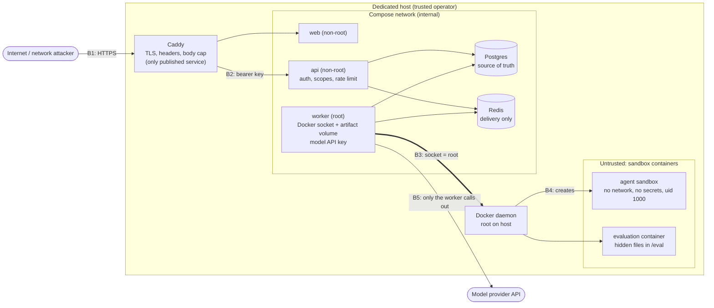

# Security review

Phase 8, step 3 (ADR-012 G). A review of the code and configuration at the head of the
`phase8/security-readme` branch (base `6a11cde`), with fixes made in the same change.

**AgentEval is a research and portfolio sandbox. It is not a hardened multi-tenant security
boundary.** It runs untrusted code in Docker containers that share the host kernel, and its worker
holds the Docker socket, which is root-equivalent on the host. Run it on a dedicated machine, for
callers you trust with that machine. Nothing in this review claims otherwise.

Contents: [Scope and method](#scope-and-method) · [Threat model](#threat-model) ·
[Controls per threat](#controls-per-threat) · [Findings](#findings) ·
[Accepted risks and their rationale](#accepted-risks-and-their-rationale) ·
[Residual risks](#residual-risks) · [How to re-run the checks](#how-to-re-run-the-checks)

## Scope and method

In scope: the API (`apps/api`), the worker and its sandboxes (`apps/worker`), the domain package
(`packages/core`), the dashboard (`apps/web`), the Dockerfiles, `docker-compose.yml`,
`docker-compose.prod.yml` and the Caddyfile.

Out of scope: the host operating system, the Docker daemon, Postgres, Redis, Caddy and Next.js
themselves (only how they are configured here), and any real model provider's behaviour.

Method. Every item below was checked against the code or the running system, not assumed:

- **Read the code paths** that handle untrusted input: request parsing and validation, the auth
  guard, the key service, every SQL construction site, error handlers, the artifact store, the
  sandbox container settings and the evaluation container, the tools, the dashboard's rendering.
- **Grepped for the dangerous patterns:** `text(` and f-strings near SQL (every hit is a constant or a
  server-side integer), `dangerouslySetInnerHTML` / `innerHTML` / `eval(` in the dashboard (none),
  secrets in tracked files (only the two `.env*.example` files are tracked).
- **Probed the live stack** (`make up`) with hostile input: a NUL character in a task file, a 50 MB
  body, a 100,000-level nested JSON array, unauthenticated reads, and the open endpoints.
- **Inspected a running sandbox** from the inside: `/proc/self/status` (`NoNewPrivs`, `Seccomp`,
  `CapEff`), `/proc/mounts`, the environment, the Docker socket path and name resolution.
- **Ran the dependency audits** (`pip-audit` on the exact `uv.lock` pins, `npm audit`).
- **Brought up the production compose files** under a separate project name and ran a task through
  them after the hardening changes below.

Limits of the method: no fuzzing campaign, no external penetration test, no review of third-party
code, and TLS termination on ports 80/443 could not be exercised on the review host (the Caddyfile
was validated with `caddy validate`).

## Threat model

### Assets

| Asset | Why it matters |
|---|---|
| The host and its Docker daemon | The worker can ask the daemon for anything |
| Model provider credential (`ANTHROPIC_API_KEY`) | Costs money; belongs to the operator |
| API keys | Bearer credentials with read, write or admin scope |
| Hidden evaluation data (ADR-007) | If an agent sees the hidden tests, the benchmark is meaningless |
| Run, trajectory and score data | The product's output; its integrity is the point |
| Platform availability | A runaway or hostile input must not take the queue or the API down |

### Actors

| Actor | Trusted? | Capability |
|---|---|---|
| **Candidate code / the agent** | No | Runs arbitrary code in a sandbox container; chooses tool calls; can try to read hidden tests, escape, or exhaust resources |
| **Task author** | Partly | Holds a `write` key; supplies task files, commands and evaluation specs |
| **API caller** | Only as far as its scopes | `read`, `write` or `admin` key; may also be a caller with no key |
| **Prompt-injected agent** | No | Text inside task files or tool output tries to steer the model |
| **Network attacker** | No | Reaches whatever the deployment publishes (Caddy only, in production) |
| **Operator** | Yes | Holds the host, the env file and the first admin key |
| **Compromised worker** | No (assumed) | Treated as full host compromise: the socket makes it root-equivalent |

### Trust boundaries



The boundaries that matter, strongest assumption first:

- **B3 (worker to Docker daemon) is not a security boundary.** It is a trust assumption: the worker
  is trusted.
- **B4 (sandbox containers to the host)** is Docker's: namespaces, cgroups, a default seccomp
  profile, dropped capabilities and no network. Sandboxes share the host kernel.
- **B2 (API callers to the platform)** is the API-key check with scopes and rate limits.
- **B1 (internet to the deployment)** is Caddy: TLS and headers, with one published port pair.
- **B5:** the model key exists only in the worker's environment.

## Controls per threat

| Threat | Controls | Where |
|---|---|---|
| Candidate code escapes the container | No network; read-only rootfs; tmpfs mounts are `noexec,nosuid,nodev`; uid 1000; all capabilities dropped; `no-new-privileges`; Docker's default seccomp profile; one container per attempt, always removed | `sandbox/session.py:198-222`, `sandbox/evaluation.py:63,218-220`; verified from inside by `test_docker_sandbox.py` |
| Candidate code exhausts resources | Memory limit with no swap; CPU quota; `pids_limit=128`; tmpfs size caps; wall-clock timeout with a worker backstop; output buffers bounded; orphan sweep by deadline label | `session.py:207-212` (limits), `BoundedBuffer`, reconciler step 8 |
| Candidate code steals credentials | The model key is only in the worker's environment; a container created over the socket inherits none of it and has no socket mount | `docker-compose.yml:84,93`; `test_the_workers_environment_never_reaches_the_sandbox` |
| Candidate code reaches internal services | `network_mode=none`: no interface, no DNS | `session.py:207`; `test_the_sandbox_cannot_reach_the_internal_services` |
| Agent reads the hidden tests | Hidden files are written into the *evaluation* container only, in a root-owned `/eval`, after the attempt ended; the agent container never has them; specs are write-only and every response goes through one projection | ADR-007, `evaluation/public.py` |
| Agent tampers with tests to pass | `protected_paths` baseline compared in the evaluation; tampering forces the score to 0 | ADR-006 |
| Agent path traversal through tools | Paths validated lexically (no absolute, no `..`, normalised, no NUL); everything runs inside the container, so a symlink can only reach container files; arguments are argv or positional `sh` parameters, never spliced into a shell string | `schemas/task.py:27-35`, `tools/builtin.py` |
| Prompt injection | Limits the reach (the version's tools, inside the container) and the cost (step, token, cost and time budgets); it is not prevented | ADR-005 |
| Unauthenticated API access | Every `/api/v1` route requires a key; a test fails if a route has no scope | `auth.py`, `test_auth_api.py` |
| Privilege escalation between scopes | Independent `read` / `write` / `admin` scopes checked after the rate limit | `auth.py:107-113` |
| Key guessing, key theft from the database | 256-bit secrets; only a SHA-256 digest stored; constant-time comparison; a dummy digest for unknown prefixes; revoked or expired reported only after a matching secret | `services/api_keys.py:81-110` |
| Abusive authenticated clients | Per-key Redis budgets (read 600/min, write 120/min), 429 with `Retry-After` | `ratelimit.py` |
| Oversized or hostile request bodies | Body cap (default 5 MiB, 413 before parsing); per-field limits (1 MB of task files, 2 MiB spec, 64 args, paging caps, 10 repetitions, 1000 runs per batch) | `middleware.py` (`BodyLimitMiddleware`), `schemas/` |
| SQL injection | SQLAlchemy Core/ORM with bound parameters; the only interpolated SQL fragments are module constants and server-side integers (the full list is in F-A8) | `repositories/` |
| Information leakage through errors | 422s never echo the submitted input; the evaluation spec gets fixed messages; unhandled errors are a plain 500 with no traceback; a database data error is a fixed-text 422 | `errors.py` |
| Secrets in logs | A structlog processor redacts `sk-ant-...`, `ae_...` keys, `Bearer ...` text and credential-named fields; request logs carry the path, never the query or headers | `logging.py:14-60`, `auth.py:131` |
| Cross-origin abuse of the API | CORS only for the configured dashboard origins; no cookies (`allow_credentials=False`), so ambient browser credentials do not exist | `main.py:66-85` |
| Duplicate or replayed requests | Idempotency keys (bounded to 255 characters, unique in Postgres) | `routes/runs.py:27` |
| Artifact path traversal | Keys are derived (`<attempt uuid>/<kind>-<sha256>.tar.gz`); every path is resolved and checked to stay under the root; reads verify size and SHA-256; listings do not follow symlinks | `artifacts/store.py:64,105` |
| Malicious snapshot tarballs | Validated header by header on the host (no absolute paths, `..`, links out, device nodes; member and size caps), and only ever unpacked inside a sandbox | `sandbox/evaluation.py:160` |
| Disallowed images | The API rejects images not on `AGENTEVAL_IMAGE_ALLOWLIST`; the worker checks again before it creates any container; the worker never pulls | `services/tasks.py:34-35`, `session.py:99` |
| Network exposure of internals | Production publishes only Caddy; Postgres and Redis need passwords and publish nothing; `/metrics` is answered 404 by Caddy | `docker-compose.prod.yml`, `Caddyfile` |
| Clickjacking and MIME sniffing of the dashboard | `X-Frame-Options: DENY`, `frame-ancestors 'none'`, `nosniff`, `Referrer-Policy`, `Permissions-Policy`, HSTS | `Caddyfile`, `apps/web/next.config.ts` |
| XSS in the dashboard | React escapes every value; no `dangerouslySetInnerHTML`, `innerHTML` or `eval` anywhere in `apps/web`; trajectory text, tool output and error messages render as text nodes | grep over `apps/web/{app,components,lib}` |
| Vulnerable dependencies | `pip-audit` and `npm audit` run in CI on every change | `.github/workflows/ci.yml` |
| Compromised process inside a service container | API, worker, web and Caddy drop all capabilities and set `no-new-privileges` in production; the API also has a read-only root filesystem | `docker-compose.prod.yml` |

## Findings

Severity is the impact if the weakness were exploited in the intended deployment (a dedicated
host, a trusted operator, keys issued to people the operator trusts). **Fixed** means fixed in this
change, with the test named. **Accepted** means left as is, with the rationale in the next section.

| ID | Severity | Finding | Evidence | Status |
|---|---|---|---|---|
| F-P1 | **High** | The worker mounts `/var/run/docker.sock`: anyone who controls the worker process controls the host as root. Candidate code never sees the socket, so the exposure is a worker bug or a stolen worker, not a sandbox escape. | `docker-compose.yml:93`; `worker.Dockerfile` (runs as root) | **Accepted** (A1) |
| F-W2 | **Medium** | Sandboxes share the host kernel. A kernel or runtime vulnerability reachable through the default seccomp profile would escape the container. | `session.py:198-221` (Docker defaults, no gVisor/Kata) | **Accepted** (A2) |
| F-A1 | **Medium** | The API read request bodies of any size into memory before the field limits ran. Reproduced: a 50 MB `POST /tasks` was fully parsed (then rejected with 422). Only the production Caddy capped bodies (5 MB), not the API itself or the development stack. | `middleware.py` (before: none); `main.py:62` | **Fixed**: `BodyLimitMiddleware`, `AGENTEVAL_MAX_REQUEST_BYTES` (default 5 MiB), 413 problem+json. Tests: `apps/api/tests/test_body_limit.py`, `tests/integration/test_input_hardening.py` |
| F-A2 | Low | A `\u0000` character in a task file (or any text or JSON field) made Postgres reject the insert and the API answered **500**. Reproduced live. No leak, but an unhandled error reachable by any `write` key, and it counted as a server fault. | `routes/tasks.py` to `TaskRepository.add`; before the fix `POST /api/v1/tasks` with `"files": {"a.py": "x\u0000y"}` returned 500 | **Fixed**: SQLSTATE class 22 maps to a fixed-text 422 (nothing from the driver message); other database errors stay 500. Tests: `test_input_hardening.py` |
| F-W1 | Low | The image allowlist was enforced only by the API when a task was created. The worker, which holds the socket, trusted whatever image name the database held. | `services/tasks.py:34-35` (API); worker had no check | **Fixed**: `check_image_allowed` before every container creation (command, agent and evaluation), non-retryable reason. Tests: `test_a_worker_refuses_an_image_that_is_not_on_its_allowlist`, `test_a_sandbox_refuses_an_image_outside_the_workers_allowlist` |
| F-P3 | Low | Production containers ran with Docker's default capability set and could gain privileges through setuid binaries. | `docker-compose.prod.yml` (before: no `cap_drop`, no `security_opt`) | **Fixed**: `cap_drop: [ALL]` and `no-new-privileges` on api, worker, web and caddy (caddy keeps `NET_BIND_SERVICE`); the API also gets `read_only: true` with a tmpfs `/tmp`. Verified by running the production files under a separate project name: API and worker healthy, a command task `COMPLETED SUCCESS`, `CapEff` of the worker `0000000000000000`. Postgres and Redis keep their image defaults (their entrypoints drop privileges themselves) |
| F-P5 | Low | The reverse proxy sent no `X-Frame-Options`, CSP or `Permissions-Policy`, and HSTS had no `includeSubDomains`; the dashboard served directly (`make web-up`) sent no security headers at all. | `Caddyfile` (before), `next.config.ts` (before) | **Fixed**: headers added in both places (`script-src` deliberately unrestricted, see A6). `caddy validate` passes. Test: `apps/web/tests/security-headers.test.ts` |
| F-W3 | Low | Candidate code that runs *inside* the grading process (a `python_tests` check) can read the hidden files in `/eval` and cheat in-process (ADR-006 C7). | ADR-006, ADR-007 | **Accepted** (A3); `io` checks are the robust choice |
| F-A3 | Low | Requests with an invalid key are not rate limited (the budget is keyed by a verified key); each costs one indexed lookup and one SHA-256. | `auth.py:117-133` | **Accepted** (A4) |
| F-A4 | Low | `/metrics`, `/docs`, `/openapi.json`, `/health` and `/ready` need no key on the API's own port. | `routes/metrics.py`, `main.py` | **Accepted** (A5): loopback in development; in production Caddy answers `/metrics` 404 and does not route `/docs` or `/openapi.json` at all |
| F-A5 | Low | A run's or attempt's `error_message` can carry the text of an unexpected exception or a Docker daemon error. It is visible to any `read` key. No credential is stored there (credentials never enter these code paths), but it can name an image or an internal host. | `schemas/run.py:48,89`, `executor.py` | **Accepted** (A7) |
| F-P4 | Low | The dashboard keeps the API key in `sessionStorage`; a script running on the dashboard's origin could read it. | `apps/web/lib/auth.ts:21-31` | **Accepted** (A6): no injection point found; headers added; the trade-off is recorded in ADR-012 D |
| F-P2 | Low | The development compose file uses fixed database credentials (`agenteval` / `agenteval`) and a Redis without a password. | `docker-compose.yml:20-23,35-45` | **Accepted** (A8): bound to `127.0.0.1`; production requires both passwords and publishes neither |
| F-P7 | Low | The API and the worker connect to Postgres as the same role, so an API bug has the worker's privileges (and the reverse). | `docker-compose.yml:12` | **Accepted** (A9) |
| F-A6 | Info | The platform is single-tenant: any `write` key can cancel or replay any run, any `read` key sees every run and trajectory, and idempotency keys share one namespace. | ADR-012 B | **Accepted**, by design |
| F-A7 | Info | No global quota on queued runs: a `write` key can enqueue work at its rate limit, bounded per run by the step, token, cost and time caps, per batch by 1000 runs. | `services/evaluations.py:295` | **Accepted** |
| F-A8 | Info | SQL review. Every `text()` and f-string site was read. Interpolated fragments: `SET LOCAL statement_timeout` from `int(...)` (`artifacts.py:163`), `STATEMENT_TIMEOUT` / `IDLE_IN_TRANSACTION_TIMEOUT` module constants (`recovery.py:113-115`), the keeper's table name and status list from a fixed dict keyed by a two-value literal (`keeper_process.py:31-58`), and the migration DDL. User values are always bound parameters. | listed | No issue found |
| F-D1 | Info | Dependency audit: `pip-audit` on the exact `uv.lock` production pins reports **0 known vulnerabilities**; `npm audit --omit=dev` reports **0**. `npm audit` including development dependencies reports 5 high-severity advisories in the `eslint-config-next` chain, which is never installed in the runtime image (`web.Dockerfile` copies only the standalone build). | commands below | **Accepted**: development tooling only; CI gates on production dependencies |
| F-W4 | Info | Verified controls that no test covered before, now pinned by tests that inspect a live container: `NoNewPrivs=1`, `Seccomp=2`, no worker environment variable visible (including PID 1's), no Docker socket, no name resolution, every writable mount `noexec,nosuid,nodev`. | `apps/worker/tests/test_docker_sandbox.py` | **Added tests** |
| F-P6 | Info | Artifact files are created `0644` on a volume only the workers mount. | `artifacts/store.py:_put` | **Accepted**: the volume is not shared with the API or the sandboxes |

## Accepted risks and their rationale

- **A1, the Docker socket (F-P1).** The worker creates sibling containers through the daemon; there is
  no way to do that without a socket or an equivalent API. What reduces the exposure: the socket is
  mounted into the worker only, never into a sandbox or the API; the worker is a small trusted
  codebase that executes no candidate code in its own process; it drops all capabilities and cannot
  gain any; it refuses images outside the allowlist; it never pulls; only the production reverse
  proxy is reachable from outside. What would remove the risk: a socket proxy that allows only
  `containers create/start/exec/kill/remove` with enforced settings, rootless Docker, or a
  dedicated VM per deployment. None is built; the deployment guide tells the operator to use a
  dedicated host.
- **A2, shared kernel (F-W2).** Container isolation is not VM isolation. The mitigations are the
  standard ones (no capabilities, `no-new-privileges`, default seccomp, read-only rootfs, no network,
  no mounts from the host). Hardening further means gVisor, Kata or Firecracker, which is a runtime
  swap, not a configuration change. Do not run untrusted agents on a host that holds anything you
  cannot lose.
- **A3, in-process grading attacks (F-W3).** Documented in ADR-006 C7. Candidate code runs inside the
  test process, so it can read what that process can read. `io` checks compare output on the host and
  are not affected.
- **A4, unauthenticated floods (F-A3).** Guessing a key is not feasible (8-character prefix plus 256
  random bits), so the cost is request volume, which is a network-layer concern (Caddy, a firewall,
  the host's connection limits). A limiter keyed by client IP would help a little and misattribute
  everything behind a proxy.
- **A5, open probes (F-A4).** `/health` and `/ready` reveal only up or down and the error *type*
  (`error: ConnectionRefusedError`), which orchestrators need. `/metrics` has no secrets or ids by
  design (ADR-010: labels are closed sets), and the production proxy blocks it.
- **A6, the dashboard key and the CSP (F-P4).** A bearer token in `sessionStorage` is readable by any
  script on the origin. The dashboard has no known injection point (React escaping, no raw HTML),
  loads no third-party scripts, and now forbids framing. `script-src` is not restricted because Next.js
  emits inline bootstrap scripts; a nonce-based policy needs per-request rendering. A `read` key limits
  what a stolen token can do.
- **A7, error text (F-A5).** The text helps an operator debug without shell access. The platform is
  single-tenant and `read` keys are issued by the operator. Not accepted for a multi-tenant product.
- **A8, development defaults (F-P2).** Convenience for localhost.
- **A9, one database role (F-P7).** Splitting roles needs grants for every table each side touches.
  Worth doing before multi-tenant use, not for this scope.
- **A10, the local sandbox backend of the free-hosting demo.** Added after this review. With
  `AGENTEVAL_SANDBOX_BACKEND=local` the worker runs task commands as its own subprocesses: same
  user, same network, the container's Postgres and Redis one connection away. Every control in
  this document that relies on the container is absent; a per-run directory, a scrubbed
  environment, rlimits, process-group timeouts and a reaper remain, as hygiene. It is accepted
  only in the single-container demo (`infrastructure/docker/api-demo.Dockerfile`), whose API runs
  with `AGENTEVAL_PUBLIC_DEMO=true`: visitors cannot create agents, versions, tasks or datasets, so
  every command that runs comes from a seeded agent's fixed script and a seeded task. The demo's
  data is disposable and it holds no credentials worth taking. Turning on new agents or tasks in
  such a deployment, or the local backend anywhere else, removes the reason this is acceptable.

## Residual risks

Even with every item above handled, these remain and are the honest summary of the security model:

1. A bug in the worker, or a Docker/kernel vulnerability, is a host compromise.
2. Prompt injection is expected and bounded, never prevented.
3. Execution is at-least-once: a recovered attempt re-runs an agent and pays for its model calls again.
4. A leaked API key grants its scopes until it is revoked; there is no automatic rotation, no
   per-user audit trail beyond the key name, and no per-object ownership.
5. Rate limiting fails open when Redis is down (by decision, ADR-012 C).
6. TLS, certificate renewal and DNS are Caddy's and the operator's; the review host could not
   exercise ports 80/443.
7. Candidate code can read hidden files during in-process grading (A3).
8. The sandbox image's contents (Python and coreutils from `python:3.12-slim`) are as patched as the
   last time someone rebuilt it; mutable tags are not pinned by digest.

## How to re-run the checks

```bash
# Dependency audits (what CI runs)
uv export --frozen --all-packages --no-dev --no-emit-workspace --no-hashes \
  --format requirements.txt -o /tmp/requirements-audit.txt
uvx pip-audit --requirement /tmp/requirements-audit.txt --no-deps --disable-pip
(cd apps/web && npm audit --omit=dev --audit-level=high)

# Tests added or extended by this review
uv run pytest -q -p no:cacheprovider apps/api/tests/test_body_limit.py \
  tests/integration/test_input_hardening.py apps/worker/tests/test_docker_sandbox.py \
  apps/worker/tests/test_session_units.py
(cd apps/web && npx vitest run tests/security-headers.test.ts)

# Reverse-proxy configuration
docker run --rm -e AGENTEVAL_DOMAIN=agenteval.example.com \
  -v "$PWD/infrastructure/caddy/Caddyfile:/etc/caddy/Caddyfile:ro" \
  caddy:2.10.2-alpine caddy validate --config /etc/caddy/Caddyfile
```
